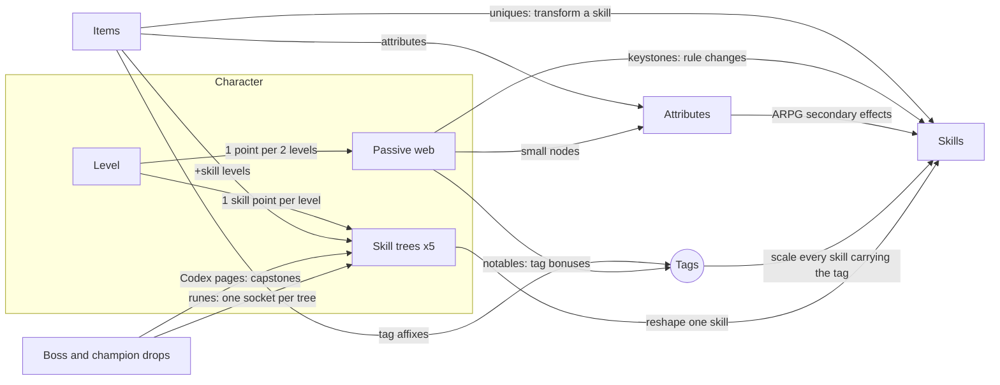

# ARPG character design: skills, passives, attributes and items

Design, not built; Jeff's decisions are recorded where they apply. This replaces the first skill tree (`ARPG-SKILL-TREES.md`, a vanilla talent
grid with ARPG nodes mixed in), after Jeff's review of it in game: it didn't look or play like an
ARPG tree. This doc rethinks how the character systems fit together, then plans the paladin in
full.

Read `ARPG-UNIQUES.md` first: its mechanic kit (chain, arc, burst, pierce…) is one of the
building blocks here.

## What was wrong with the first tree

- **It was a talent grid.** Three columns, tiers, no paths. ARPG trees are about routes: you see
  where you want to end up and plan a path there, and the nodes on the way are part of the choice.
- **Most nodes were vanilla talents.** "+1% crit per rank" five times is the least ARPG thing
  there is.
- **It didn't talk to anything.** Items gave stats, the tree gave stats, skills did what they
  always did. In an ARPG the fun is in the overlaps: an item that makes a tree node better, a
  stat that makes a skill change shape, a skill node that only shines with a certain item.
- **Skills had no depth.** A Judgement build and a Consecration build were the same character
  with different talents ticked.

## The four pillars

1. **Build around skills.** A character is defined by the five skills it specialises in, and
   each of those skills has its own tree that changes how it plays. This is the Last Epoch model,
   and it fits vanilla well: vanilla classes already have the spells, they just lack depth.
2. **One shared language: tags.** Every skill, node and item affix speaks in the same tags
   (Holy, Area, Seal, Melee…). "+20% Area damage" on a ring means something to Consecration and
   Holy Wrath and nothing to Judgement, so items and nodes pick the skills they help without a
   special case each.
3. **Attributes mean something in ARPG terms.** Strength, Agility, Stamina, Intellect and Spirit
   keep what vanilla gives them and gain one ARPG effect each (bigger areas, faster movement,
   shorter cooldowns…). Gearing for Spirit then becomes a build decision, not a healer stat.
4. **Items feed the trees.** Affixes can add levels to a skill (more points in its tree), boost a
   tag, or raise an attribute that a skill node scales with. Uniques transform skills outright.

## How the systems connect

Five layers, one direction of flow: **everything ends up changing what a skill does.** That's
the test for any new node or affix: which skills does it change, and how would a player notice?

## Tags

Every class spell gets tags in server data. Nodes and affixes reference tags, never spells,
unless they belong to one skill's own tree.

| Group | Tags |
|---|---|
| Damage type | Physical, Holy, Fire, Frost, Arcane, Nature, Shadow |
| Delivery | Melee, Spell, Projectile, Area, Ground (lingering zones), Channel, Duration (DoTs, buffs) |
| Role | Heal, Control (stuns, roots, sheep), Movement, Minion, Aura, Seal, Curse, Shout, Totem |

Paladin examples:

| Skill | Tags |
|---|---|
| Strike (the held swing) | Melee, Physical |
| Seals | Seal, Holy, Melee |
| Judgement | Spell, Holy |
| Consecration | Spell, Holy, Area, Ground, Duration |
| Hammer of Justice | Spell, Control, Projectile (once its tree makes it one) |
| Holy Light / Flash of Light | Spell, Holy, Heal |
| Auras | Aura, Holy |

A tag bonus is a damage or healing multiplier the server applies when a spell carrying the tag
lands: one hook in the spell damage and healing bonus path, summing the player's bonuses for
the spell's tags.

## No hit

There is no hit stat. An ARPG player's swings, shots and spells, and those of its pets and
totems, never miss: the melee and ranged miss roll, the spell miss roll and the hit share of the
magic resist roll are all zero. Dodge, parry, block and resistances still apply. Vanilla's +hit
items do nothing, and no affix gives hit.

## Damage

**Built:** `Arpg/ArpgDamage.{h,cpp}` and `DamagePartsFor` in `Arpg/ArpgCharacter.cpp` on the server.
The first damage model added every bonus into one percentage, so each upgrade was the same small
bump, worth less the more you had. A hit is now built in layers, as Path of Exile and Last Epoch
build theirs, and the numbers are ARPG-sized.

| Layer | What it is | Where it comes from |
|---|---|---|
| **Base** | Vanilla's: the weapon's swing or the spell's points, with attack power or spell damage by vanilla's coefficients | Gear's vanilla stats |
| **× Size** | The power scale: 1 + 0.1 per level past the first (×6.9 at 60). Every creature's health grows to match, so the size of the numbers changes, not the fight | `Arpg.Power.PerLevel` |
| **× Increased** | One sum of every "increased" bonus that fits the hit's tags | The web's small nodes, item affixes, Strength, Intellect, Spirit, Holy Weapons |
| **× More** | Each "more" bonus multiplies on its own | Notables, keystones, skill tree nodes, the uniques' readied procs |
| **× Critical** | Vanilla's multiplier (2 for attacks, 1.5 for spells) plus Agility's and gear's | Agility, "+% critical strike multiplier", "+% spell critical strike damage" |

So "+12% Holy damage" on a ring joins a pool that may already hold 150%, while Radiance's "8% more
Judgement damage" per rank multiplies everything else. Specialising a skill (its tree's more
nodes) is a build's big multiplier; gear's increased bonuses are its breadth.

The size applies only against creatures: a duel stays vanilla's. Everything that turns a flat
number into damage grows with it (thorns, Martyr, Martyr's Ward, Holy Hammer's and Blessed
Hammer's attack-power hits, the Lightforged and Dawnbringer bolts made from a heal, damage shields
such as Retribution Aura, spells immune to caster modifiers), and everything that turns damage
into health or mana shrinks back (leech, Rune of Leech, Light of the Crusader, a thorned
champion's recoil).

**Creature health:** vanilla's × the size at the creature's level × (1 + 0.5 × level ÷ 60), about
×10 at 60; the extra half is for the bonuses a character builds up. A raid's creatures grow again
with the gear the raid drops: × (1 + (raid item level − 60) ÷ 20), so Molten Core ×1.3, Blackwing
Lair ×1.7, Temple of Ahn'Qiraj ×2, Naxxramas ×2.4, on top of the solo scaling and the tier. Both
are `mangosd.conf` settings (`Arpg.Power.PerLevel`, `Arpg.Power.HealthGrowth`). The ARPG world
hosts ARPG players only: a stock client there would face the health without the damage.

### Added damage

"Adds 70 to 164 Fire damage to attacks" (weapons, gloves and jewellery). Each damage type the
gear adds lands as **its own hit** beside the main one. It hits in its own school with its own
look (Fireball's impact for Fire, Smite's for Holy...), and takes its own type's increased
bonuses with the main hit's delivery (Melee, Spell, Area) and the skill's more bonuses. It is
critical when the main hit was, and it can inflict its own ailment. Swings take the attack
affixes, spells the spell ones; a Seal's proc takes none, as the swing it rides on has them
already; at most the two biggest types land beside one hit. The
affix shows and deals its numbers at the ARPG's size for the item's level, eight times vanilla's
stat growth, so an affix lands near a fifth of the hit it rides on (at vanilla's size it was about
2%, noise beside a skill). This is what makes an
off-type affix worth having: a Holy paladin with Fire added to attacks ignites.

### Ailments

Each damage type has one. **A critical strike always inflicts its type's ailment**, and "% chance
to Ignite" (and the others) adds a chance on any hit. Ailment damage grows with "increased damage
with ailments", "damage over time" and Spirit, on top of the hit it came from.

| Type | Ailment | Effect |
|---|---|---|
| Physical | **Bleed** | 60% of the hit over 5 sec, doubled while the target moves; the strongest counts; armour reduces its ticks |
| Fire | **Ignite** | 80% of the hit over 4 sec; the strongest counts |
| Nature | **Poison** | 30% of the hit over 3 sec; stacks (20 at once), their ticks landing as one hit |
| Frost | **Chill** | Slowed (Improved Blizzard's chill); a critical hit on a chilled target **freezes** it (Frostbite) |
| Shadow | **Wither** | It takes 4% more damage from you per stack, 10 at most, for 4 sec after the last |
| Arcane | **Overload** | Half the hit is stored; 3 sec after the first, it bursts on the target and those within 6 yd |
| Holy | **Judged** | A quarter of the hit is stored per stack; at 5 stacks a Holy blast (Holy Wrath's) strikes the target and those within 6 yd for all of it |

Judged is the paladin's: every critical Seal, Judgement, Exorcism or Holy Wrath judges, and a
pack that takes five goes up in light. Burst radii grow with spell area.

### Showing it

The Skills tab's Bonuses button lists, per skill: the size, the increased sum, the more product,
each bonus that applies now and where it comes from, the critical multiplier, the added damage,
and the ailments with their chance and bonus. The estimate and the last minute's hits follow.

**Comparisons** (`Arpg/ArpgCompare.{h,cpp}`, `SMSG_ARPG_COMPARE` 0x34C): every wearable item in
the bags says, under its affixes, what it would do to each slotted skill's damage if worn in
place of what is there ("Worn in place of Band of Flesh: Judgement +12% damage, Strike −3%
damage"). Each skill gets a score, its expected damage a use (Strike: a second), from the same
pieces as a hit: attack power and the weapon or the spell's points and spell damage, the
increased sum, the more product, critical strike chance and multiplier, added damage, and the
ailments it should inflict. The score is worked out with the gear worn and with the item swapped
in. The item's vanilla stats count (its own, its equip spells' and its "of the Bear" suffix's),
and so do its affixes. It is an estimate: Agility's and Intellect's vanilla critical strike chance,
set bonuses and the target's armour are left out. The server sends the whole set once a second
when the gear, the bags or the character's numbers changed; the client shows the lines after the
item's affixes.

## Attributes

The five vanilla attributes keep their vanilla effects, so every vanilla item still works as
designed. Each gains one ARPG effect, at rates that make a dedicated gearer notice without
making the stat mandatory:

| Attribute | Vanilla (unchanged) | ARPG effect | Rate (proposed) | Cap |
|---|---|---|---|---|
| **Strength** | Attack power, block | Melee area: bigger arcs, cleaves and shockwaves; increased Melee and Physical damage | +1% size per 10 Str; +1% damage per 5 | +40% size |
| **Agility** | Crit, armour, dodge, ranged AP | Movement speed (over a base +10%); critical strike multiplier | +1% per 20 Agi; +1% multiplier per 5 | +30% speed with the base |
| **Stamina** | Health | Life on kill | Stamina ÷ 4 per kill | none |
| **Intellect** | Mana, spell crit | Spell area: bigger Consecration, Holy Wrath, Blizzard; increased Spell damage | +1% radius per 10 Int; +1% damage per 5 | +40% radius |
| **Spirit** | Regeneration | Cooldown recovery; increased damage over time and with ailments | +1% per 10 Spirit; +1% damage per 5 | +30% cooldown |

Pacing (built, `Arpg/ArpgCharacter.cpp`): mana returns from fighting, slowly enough that spells
and drains show (0.5% of the maximum per swing that lands, 0.5% for a skill hit at most once a
second, 2% per kill, and each swing and skill hit adds the mana on
hit of the web's Bloodthirst and Devotion nodes and the "+N mana on hit" item affix), and five seconds out of a fight (out of combat, no hit dealt or
taken) health flows back at 5% a second and mana at 2%, so nobody sits down to drink, but a run
between packs is not a refill. Every class spell's global cooldown is a
third of vanilla's (0.5 sec) and its cast time half.

Other ARPG stats exist only on items and tree nodes, never as base attributes: area size,
cooldown recovery, movement speed, life on kill, mana on hit, damage per tag, extra projectiles,
extra chain jumps, and skill levels.

**Why these five:** each is something ARPG builds chase, each maps to a vanilla stat's flavour
(Strength is big swings, Intellect is big spells, Spirit is staying in the fight), and none
replaces a vanilla effect. The rates are a starting point, to tune in play.

## Skills and skill trees

### Specialisation

Jeff's calls: slots unlock by level and show on the bar; points come from character levels;
drops gate the biggest upgrades; and spells have no ranks.

- **Five slots, unlocked by level:** the first at level 1, then 10, 20, 30 and 40. Vanilla hands
  out spells slowly, so this follows its pace, and each new slot is a levelling milestone.
- **The bar is the build:** a specialised skill sits on the ARPG bar (left-click, right-click,
  keys 1 to 4), so what's on the bar is what the character is. Buffs, Blessings and utility spells
  stay castable from the spellbook, without a tree.
- **Skill points: one per level from level 2,** 59 at 60 against five trees of 20, so a character
  fills two or three skills and dabbles in the rest (playtest at 20: two a level was far too
  strong). Points go into whichever specialised skill you like, so a character can rush one skill
  early. A character with more spent than its level gives gets them all back at login.
- **Items raise a skill past 20:** "+2 to Judgement" raises that skill's cap to 22 and gives the 2
  points, spendable only in Judgement.
- **Respec is free:** points move freely within and between trees, and unslotting a skill refunds
  its points.
- **Drops gate the biggest upgrades:** capstones need a Codex page, and each tree has a rune
  socket. See "Drops that unlock skills" below.

### Support and defence skills feed the attacks

Nothing forces a defensive or support pick, but every defence and support tree has a branch that
makes the attack skills hit harder, so five attack skills is the weaker build. Paladin examples:

- **Auras:** Sanctity Aura gives +10% Holy damage; Wide Aura spreads it to the whole pack you're
  fighting.
- **Divine:** when Divine Shield ends, your next three Judgements are critical strikes.
- **Hammer of Justice:** your damage is 15% more on stunned enemies (Sentence Passed).
- **Seals:** they are the swing's damage, and one skill with it (Crusader). A swing build without
  Seals is half a build.

### What a skill tree looks like

Each tree is a small graph of 12 to 16 nodes, rooted at the skill itself, with three or four
branches and one or two capstones at the ends. The branches compete for the same 20 points.

| Node kind | Look | What it does | Built from |
|---|---|---|---|
| Modifier | Small circle | Numbers: more damage, less cost, bigger radius, longer stun | `SpellModifier` (cmangos spell mods by the skill's family mask) |
| Transformer | Diamond | Changes how the skill works: chains, splits, becomes a projectile, changes damage type | The uniques kit, plus per-skill hooks |
| Synergy | Hexagon | Interacts with another skill or a tag: "Judgement on an enemy in your Consecration..." | Small per-node hooks |
| Capstone | Large star | A big rule change at the end of a branch; needs its Codex page to learn | A hook per capstone |
| Rune socket | Ring | Holds one rune: a portable mechanic for any skill whose tags fit | The uniques kit |

## Drops that unlock skills

Points from levels keep progress steady, so a build never waits on luck for its basics. Drops
gate two things on top: the capstones, and a rune socket per skill.

### Codex pages: the capstones

- **Every capstone is sealed until you read its Codex page,** a book that drops from one named boss
  whose theme fits it (Whirling Strikes from Herod, Walking Consecration from High Inquisitor
  Whitemane). Read once and it's yours for that character; then you still spend points on it.
- **Each page has a home boss and a fallback.** The home boss drops it often enough that a few
  runs find it. Each dungeon's final boss drops one **Codex fragment** in its Cache, and five
  fragments make any page for a skill you have specialised. Bad luck is never a wall, only a
  slower road.
- **Why capstones:** they're the build-defining part, so finding one is an event ("I finally got
  Blessed Hammer"), and every dungeon has something a build wants from it. Leaving the rest of the
  tree open means a character is never weak for lack of a drop.

### Runes: a socket in every skill tree

- **Each skill tree has one rune socket,** opening once 10 points are in that skill.
- **Runes drop as loot** (blue and better, from bosses and champion packs) and add one portable
  mechanic to the socketed skill, if the skill carries the rune's tag. Socketing is free and
  reversible, so a new rune is an experiment, not a commitment.
- **Runes reuse the uniques kit,** so they're cheap to build and they make every skill a
  candidate for chaining, splitting or echoing, while uniques stay the strongest version of each.
  The same kit on the same skill from a rune, a unique and a tree node doesn't stack: the strongest
  applies.

| Rune | Fits | Effect |
|---|---|---|
| Chains | Spell, single target | The skill chains to 1 more enemy at 50% |
| Splitting | Projectile | +2 projectiles at 40% |
| Echoes | Spell | Every 4th cast repeats at 50% |
| Expanse | Area | +30% area |
| Lingering | Ground, Duration | +50% duration |
| Fury | Melee | Also strikes every enemy in front of you at 30% |
| Haste | Any | −25% cooldown, −15% damage |
| Leech | Any damage | 3% of the damage dealt heals you |
| Command | Control | The control effect spreads to 1 enemy nearby |
| Sanctity | Holy | +15% damage, and the skill counts as Area for Area bonuses |

**Built (Codex pages and runes):** `Arpg/ArpgSkills.{h,cpp}` and `Arpg/ArpgCodex.{h,cpp}` on the
server; the Skills tab on the client.
- *Pages:* each of the eleven built capstones is sealed until its page is read (Dual Aura waits for
  the Auras tree). A page is an item the server writes into `item_template` itself at start, so no
  SQL needs applying; picked up, it is read at once rather than going into the bags. Home bosses
  drop their page 35% of the time, plus 7 points per difficulty tier. A page already read tears
  into two fragments. Capstones taken before pages existed count as read.
- *Fragments:* one from each final boss's Cache; no other kill drops them (a page already read
  still tears into two). Five unseal any capstone of a specialised
  skill: Shift-click it in the Skills tab.
- *Runes:* the socket (top right of a skill's tree) opens at 10 points; click it to choose. Nine
  runes, each fitting some skills: Chains (Judgement, Wrath), Shattering (Judgement, Crusader,
  Wrath), Expanse (Consecration, Wrath), Lingering (Consecration, Hammers), Haste (Judgement,
  Consecration, Hammers, Wrath, Holy Light), Leech (Crusader, Judgement, Wrath, Hammers), Command
  (Hammers), Sanctity (every skill), Fury (Crusader). A kit rune on a skill whose tree already has that kit adds to it
  (Chains: one more jump on Chain of Judgement; Shattering: +15% on Hammer of Light). Runes drop
  from champions 2%, rares 8%, dungeon bosses 12%, Wardens 30%, Caches 40%. Socketing is free and
  the rune stays held; unslotting the skill empties its socket.
- *Dev tools:* the ARPG View page's Test Loot Quality has a **Codex** stop, which drops a page,
  fragments and runes.
- Saved in `character_arpg_codex`, `character_arpg_held` and `character_arpg_socket`, which the
  server creates.

### Cross-skill procs

Jeff's example: "if you crit with a melee weapon then your next Holy Light is instant cast". One
skill sets another up, so a build plays as a rotation rather than one button. Each proc has an
internal cooldown, so it paces the rotation rather than replacing it.

**Built:** `Arpg/ArpgProcs.{h,cpp}` on the server.

How a proc works:
- *Triggers:* a swing's crit, a damage spell's hit or crit, a heal's crit, a spell landing on an
  enemy (a stun), or a kill.
- *Effects:* the next cast of the named spells is instant, deals more, is a sure critical strike or
  costs no mana; or their cooldowns end now.
- *The readied cast* is a spell modifier on the player, so the client's cast bar shows the instant
  cast. It is spent by the next cast it fits and taken away when that spell is done. An instant
  spell, such as a Seal, does not spend an instant-cast proc. It also goes if it waits too long
  (8-12 seconds), or if its rune is unsocketed or its item taken off.
- *The combat log* says each one: "**Rune of Grace** readies your next Holy Light or Flash of
  Light: instant."

| Rune | Fits | Proc (internal cooldown) |
|---|---|---|
| Grace | Strike | A critical swing: the next Holy Light or Flash of Light is instant (10 s) |
| Verdict | Judgement | A Judgement that hits: the next Exorcism or Hammer of Wrath deals 50% more (8 s) |
| the Anvil | Hammer of Justice | Stunning an enemy ends Judgement's cooldown (10 s) |
| Fervour | Holy Wrath, Exorcism | A critical hit: the next Judgement is a sure critical strike (8 s) |
| Zeal | Crusader | A critical Seal hit: the next Holy Light or Flash of Light costs no mana (10 s) |

| Unique | Proc (internal cooldown) |
|---|---|
| Hand of Edward the Odd | A critical swing: the next spell is instant (20 s) |
| Ironfoe | A critical swing: the next Judgement deals 60% more (6 s) |
| Verigan's Fist | A kill ends the cooldowns of Hammer of Wrath and Exorcism (8 s) |
| Benediction | A critical heal: the next Exorcism, Holy Wrath or Holy Shock deals 50% more (8 s) |
| Staff of Jordan | A critical Frostbolt: the next Fireball or Pyroblast is instant (8 s) |
| Meteor Shard | A critical swing: the next Sinister Strike, Eviscerate, Heroic Strike or Mortal Strike costs nothing (8 s) |

The uniques' proc lines reach the tooltip with the mechanic lines (`SMSG_ARPG_ITEM_MECHANICS`).
The runes drop as the others do.

**Every unique has a power of its own.** A named blue or purple without an authored mechanic or
proc (the tables above and `ARPG-UNIQUES.md`) carries a generated one (`ArpgProcs.cpp`,
`GeneratedPowers`). It is built from four parts, with numbers that grow with the item's level:

- **Trigger:** a critical swing, a critical spell, a kill, a heavy blow (a fifth of your health),
  or a critical heal.
- **Effect:**
  - a nova of a damage type around you;
  - an arc to the 3 enemies nearest the target;
  - the slain enemy exploding (kills only);
  - an ailment burst on every enemy within 8 yards (Bleed, Judged, Ignite, Chill, Overload,
    Poison or Wither);
  - a heal, mana, a fury (more damage for 6 sec) or swiftness (movement speed for 4 sec).
- **Damage type:** for the four damaging effects, one of the seven.
- **Rider:** a smaller second effect, or none: a heal, mana, a short fury or swiftness, or an
  ailment on the target.

A hit, heal or blow sets the size of the damage (a heal's or blow's at the ARPG's size against
each creature); a kill's comes from the slain enemy's maximum health, held under 60% of yours.
Each has its own cooldown by trigger: swings 2 sec, spells 3, kills 1, blows 8, heals 5, and a
fury or swiftness no sooner than it runs out.

**The numbers** at level 60, for a hit-based trigger:
- nova 30% of the hit, arc 35%, ailment burst as a hit of 60%;
- kills 8% / 10% / 15% of the slain enemy's maximum health, explosion 12%;
- heal or mana 4% (12% and 8% on a heavy blow);
- fury 15% more damage, swiftness 20%.

They scale with the item's level: half at level 1, all at 60, then a quarter more per ten levels
(about ×1.7 in Naxxramas). So a level 20 unique's power is about two thirds of a level 60 one's.

**No two uniques of a kind share a power.** Each kind (weapons; armour; jewellery, cloaks and
off-hands) has about 1,500 combinations of trigger, effect, damage type and rider. They are dealt
out over that kind's uniques in entry order, a coprime stride apart, so set pieces that sit next
to each other draw very different powers. The server log says how many uniques of each kind
were dealt powers. The name is built from the parts ("Cinder Nova", "Rime Lash", "Greater
Bloodrush"), and the tooltip shows it in gold under the "Unique" line with its full text, for
example "A critical swing sends out a nova of fire: 30% of the hit to every enemy within 8
yards, and heals you for 2% of your maximum health (once every 2 sec)."

A readied "+damage" or "sure crit" waits for a spell that deals damage or heals, so a Seal or a
blessing in between does not waste it.

### Levels past 20

"+N to <skill>" item affixes are the only route past 20, so the third source of skill power is
plain gear. Tomes (a third drop type) aren't needed.

**Built:** four affixes, on weapons and amulets only, so they stay rare: "+1 to all Melee skills",
"+1 to all Spell skills", "+1 to all Holy skills", and "+1 to all Fire, Frost, Nature, Arcane and
Shadow skills". From about item level 69 they roll +2. They work by the skill's tags (its spells'),
so they suit every class without a table per skill: for a paladin, Holy reaches Crusader, Holy Light,
Judgement, Consecration, Hammers and Wrath, and Melee reaches Crusader.
- Each level the gear gives a skill raises its cap by one (20 + levels) and gives a point that
  only that skill can spend; those are spent first. The Skills tab's total counts them for the
  slotted skills (`ArpgSkills.cpp`, `GearSkillLevels`).
- Taking the gear off gives the points back from the deepest ranked nodes first, one at a time,
  so the rest of the tree stays; the same trim handles points rebalanced by a level change
  (it used to empty every tree). It waits until the excess has lasted 10 seconds out of combat
  with the character's gear known, so a login (the gear's affixes load after the skills) or a
  weapon swap never costs ranks. The client is sent the skills again whenever gear's levels
  change.

## Spells without ranks

- **A skill is one spell with no "Rank N".** The spellbook shows one Judgement; trainers no
  longer teach spells. A class's skills unlock at the level vanilla first gives them, for
  free; a talent-granted spell at its talent row's level (Consecration at 6, the paladin's one
  exception). Built: phase 1 gives the talent spells, phase 2 the trainer spells.
- **Base power follows your level smoothly.** The server takes vanilla's rank data for your level
  and blends between the two ranks either side of it, so damage and mana cost climb a little every
  level instead of jumping at rank 2, 3, 4.
- **On top of the base:** gear (spell power and attack power, through vanilla's coefficients),
  attributes (their ARPG effects), tags (passive and item bonuses), and the skill's own tree.
- **Downranking goes away** (a cheaper low rank for mana). Mana pacing moves into the trees and
  the web instead: Mana Strike on Crusader, Righteous Mind on Judgement, Spirit, Illumination.
- **How it's built:** first, at each level-up the server teaches the vanilla rank for that level
  and removes the lower one, and the client hides "Rank N". The smooth blend between ranks comes
  second, as a damage and cost multiplier.

## The passive web

The class-wide tree. This is the part that should look like an ARPG at a glance: a web of
nodes joined by paths, spreading out from a start node in the middle.

- **About 90 nodes per class** in three regions, one per class fantasy, joined around the start
  and by bridges between regions.
- **Allocation by adjacency:** a node can be taken only if it connects to one you have. The
  start is free.
- **Small nodes** (most of the web, 1 point): +attributes, +% tag damage, +ARPG stats.
- **Notables** (about 18, 1 point, larger and named): one meaningful effect each. Some revive the
  best vanilla talents as single strong nodes ("Vengeance" in one point, not five).
- **Keystones** (5 per class, at the region edges): rules that change how the class plays, with
  a cost attached.
- **Points:** one every second level (30 at 60), plus one for the first kill of each dungeon and
  raid final boss (about 20 more), about 50 of the web's 88 nodes. A level 60 takes about 80 of 90, so the last few choices still matter, and
  raid progress grows the build.
- **Respec:** free, out of combat.

## Items

Vanilla items keep their stats. On top of them, the ARPG layer adds:

- **Affixes on generic greens and blues** (`ARPG-ITEMISATION.md` steps 2 and 3), now drawn from
  the same vocabulary as the web:
  - **Attribute:** +Strength, +Spirit…
  - **Tag:** +12% Holy damage, +15% Area damage, +8% Seal damage.
  - **ARPG stat:** +6% movement speed, +8% cooldown recovery, +12 life on kill, +3 mana on hit.
  - **Skill:** +1 to Judgement, +1 to all Holy skills. These are rare and valuable, and they go
    in the item's fourth enchantment slot.
- **Built (rarities and affixes):** `Arpg/ArpgAffixes.{h,cpp}` on the server. Loot is Diablo's
  on vanilla's items: every weapon and armour piece dropped for an ARPG player is a base and rolls
  its rarity at the drop.
  - **Ordinary items** (vanilla's whites and greens; a green's "of the Bear" suffix stays as its
    implicit) roll **white** (no affixes), **green** (1-2), **blue** (3-4) or **purple** (5-6).
    The odds follow who dropped it (trash 50/33/13/4, a champion or open-world elite 15/40/33/12, a rare,
    Warden or boss 0/25/45/30) and lean up with the dungeon tier. The name shows the rolled
    colour, in the tooltip, the chat link and on the ground.
  - **Uniques** are vanilla's named blues and purples (and every mechanic item, `ARPG-UNIQUES.md`):
    gold, their authored stats their implicits, a power of their own, and affixes of their own.
    Which affixes, and how many (a vanilla blue 4, a vanilla purple 6), are fixed by the item, so
    every copy of a unique has the same ones; only their values roll within their ranges. The ground label's border and the beam's core, and a "Unique
    (Rare: 3 affixes)" line in the tooltip, show which.
  - A raid drop (item level 66+) or a Torment drop rolls the top of its rarity's range.
  - Wardens drop two blues, a 30% purple and a 35% unique; a final boss's Cache, per player, a
    blue, a green, a 25% purple and a 50% unique. Test loot's quality is the rarity asked for.
- **The affixes** (item level 60 values on Normal, and by the dungeon tier, x1.15 Hard up to x2
  Torment III). Flat ones (attributes, attack power, spell damage, added damage, resistances,
  life on kill, regeneration, thorns) grow as vanilla's own stats do: by half again every nine
  item levels or so, a level 20 drop about a seventh of a level 60 one. Percentages grow in step
  with the item level to 60 (a level 30 item rolls half the level 60 value, a level 40 two
  thirds, a tenth at least), so ten levels always show: "+% Holy damage" is 3-10% at 20, 5-15% at
  30, 7-20% at 40, 10-30% at 60. Past 60 both grow alike, Molten Core a third more, Blackwing Lair
  about twice, Naxxramas three to four times (Holy damage 38-114% there).
  - **Attributes:** +Strength, Agility, Stamina, Intellect, Spirit (8-30); +all attributes
    (jewellery, 4-14).
  - **Damage:** +% Holy, Physical, Fire, Frost, Arcane, Nature, Shadow (10-30), Area (12-36),
    Projectile (10-27), Melee and Spell (8-24), damage over time and channelled (10-30), Seal
    (weapons, 10-30); +% to elites and bosses (8-22); +% to Undead, Demons, Beasts, Humanoids,
    Dragonkin, Elementals (weapons, 12-36).
  - **Offence:** +attack power (10-40), +spell damage (6-24), +% attack speed (weapons, 3-8, at
    most 20), +% cast speed (3-8, at most 20), +% critical strike chance and spell critical
    strike chance (1-3, at most 8), +% spell critical strike damage (jewellery, 12-36, added to a spell's critical strike multiplier), +% melee and
    spell area (3-10), +% cooldown recovery (3-10), less mana cost (3-8%).
  - **Sustain:** life leech (weapons, 0.5-2% of damage dealt) and mana leech (jewellery,
    0.3-1.2%), +life on kill (5-40), +mana on hit (2-10), +health a second (armour, 2-10), +mana a
    second (jewellery, 1-5), +% healing (8-26), +% globe and flask healing (armour, 5-20).
  - **Defence:** +% maximum health (armour, 3-8) and mana (3-8), +% armour (armour, 5-25), +%
    block (shields, 2-6), less damage taken (armour, 2-6%, 40% in all at most), thorns (armour,
    6-30 Nature damage back at each attacker in reach), +Fire, Nature, Frost, Shadow or Arcane
    resistance (5-20), +all resistances (jewellery, 3-10).
  - **Utility:** +% movement speed (boots, 3-8), +% gold found (5-25), +% experience (jewellery,
    2-6).
  - **Damage** (see Damage above; weapons, gloves and jewellery unless said): adds Physical, Holy,
    Fire, Frost, Nature or Shadow damage to attacks (an average of 10-24 at vanilla's size, shown
    at the ARPG's: "Adds 70 to 164" at item level 60), adds Holy, Fire, Frost, Arcane, Nature or
    Shadow damage to spells (12-28), +% critical strike multiplier (10-30, at most 60), % chance to
    cause Bleeding, Judge, Ignite, Chill, Overload, Poison or Wither (any slot, 5-15, at most 40),
    +% increased damage with ailments (any slot, 10-30).
    An item stored before these existed rolls from the old list (`character_arpg_item.pool` 0), so
    its affixes never change; new drops roll from the whole list. A unique's fixed affixes always
    come from the old list, so every copy of it, old or new, has the same ones.
  - **Skill levels** (weapons and amulets, 1, 2 from about item level 69): +to all Melee, Spell,
    Holy, or Fire/Frost/Nature/Arcane/Shadow skills (see "Levels past 20").
  The roll is one seed per item, kept in `character_arpg_item` with its tier and rarity; worn
  affixes add into the same totals as the web, and the character sheet's Totals list them. The
  tooltip shows them as green lines after the item's own enchants (`SMSG_ARPG_ITEM_AFFIXES`,
  0x343, which carries the rolled colour and a unique's border too). The "+N to a skill" affixes
  are built (see "Levels past 20").
- **Built (crafting):** `Arpg/ArpgCraft.{h,cpp}` and the crafting half of `Arpg/ArpgAffixes.cpp`
  on the server, the Forge window on the client (the anvil button beside the town portal's, or
  the Forge key binding). Put an item in by dragging it onto the Forge's slot, or Alt-clicking it
  in the bags or on the character. Any weapon or armour piece takes crafting, a quest reward
  included.
  - **Orbs**, PoE's currency on vanilla's gems, drop on the ground:
    - champions 20%, rares one plus 25% for a second, dungeon bosses 1-2;
    - anything near the looter's level 1%;
    - each dungeon tier adds 5 points to these chances;
    - zone event caches 2-4, bounties 1-3, and salvage now and then.

    Picked up, they go into the character's purse, not the bags. The common ones drop most:
    | Orb | Effect |
    |---|---|
    | Orb of Awakening | A white item turns green, with 1-2 affixes |
    | Prism of Refinement | A green turns blue, adding affixes up to 3-4 |
    | Orb of Ascension | A blue turns purple, adding up to 5-6 |
    | Fel Orb | Every affix rerolled, as many as before |
    | Star of Invocation | One more affix, while the rarity has room |
    | Void Pearl | One affix, at random, gone |
    | Arcane Lens | Every affix's value rerolled |

    A unique's affixes are its own: it takes the Arcane Lens (new values) and shards that raise an
    affix it already has, but no orb or shard that changes which affixes it has.
  - **Shards**, Last Epoch's:
    - *Salvage* destroys an item from the bags. It gives a shard of one of its affixes (two from a
      blue or better), and a chance at an orb: 20% green, 35% blue, 50% purple, 60% unique (none from an item
      with no affixes).
    - *A shard* on an item adds its affix, when the affix fits the item and its rarity has room, or
      raises the value it already has a third of the way to the item's top.
    - An item takes four shard crafts in all; its tooltip counts them ("Forged 2/4").
  - A crafted item keeps its affixes as a list in place of its seed's
    (`character_arpg_item.affixes`, `forged`). An affix's id is its place in the list; new affixes
    only ever go on its end. The orbs' `item_template` rows (92001-92007) are written at start, as
    the Codex's are.
  - `CMSG_ARPG_ACTION` kind 24: `u8` op (1-7 an orb, 8 salvage, 9 a shard), `u8` bag (255 the
    equipped slots, 0 the backpack, 1-4 the bags), `u8` slot from 1, `u16` affix.
    `SMSG_ARPG_PURSE` (0x34B): `u8` orb count, per orb `u8` id, `u16` held, cstring name and
    text; `u16` shard count, per shard `u16` affix, `u16` held, cstring name.
- **Built (base items for the raids):** `Arpg/ArpgBases.{h,cpp}` on the server. Vanilla's whites
  and greens stop near item level 63, so a rolled item from a raid or a high dungeon tier used to
  be a dungeon item (a weak base, and affixes scaled from its own item level).
  - **The bank:** at start the server writes one base for every armour slot and type, cloak,
    neck, ring, shield, off-hand and weapon kind, at item levels 64, 68 ... 92 (entries 94000 up).
    Each kind comes in up to three implicit families, so that is about 140 per level, 1,100 in
    all. Each:
    - has implicits, vanilla's green suffixes, scaled to its item level and slot: of the Bear
      (Strength, Stamina), of the Tiger (Strength, Agility), of the Monkey (Agility, Stamina), of
      the Eagle (Stamina, Intellect), of the Owl (Intellect, Spirit), of Sorcery (Intellect and
      spell damage), of Healing (Intellect and healing). Spell damage and healing are vanilla's
      own equip spells. A level 64 chest carries about +14/+15, a Naxxramas one about +20/+20.
      The families fit the kind: plate is Bear, Tiger or Healing; cloth Sorcery, Healing or Owl;
      mail Monkey, Eagle or Healing; and so on;
    - has its armour, weapon damage or block fitted from vanilla's own blues and epics of its
      kind at that item level, at 90% of them;
    - wears the look of a vanilla blue or epic of its kind nearby;
    - takes a name for its content and its family: Emberforged (64), Molten (68), Draconic (72),
      Chromatic (76), Qiraji (80), Obsidian (84), Necrotic (88), Frostbound (92), as in "Molten
      Breastplate of the Bear".

    The first bank's bases (93000 up, no implicits) stay valid for anyone holding one, but no
    longer drop.
  - **Where they drop:** any rolled drop at item level 64 or more takes its base from the bank, so
    its affixes scale from that level. A dungeon's high tiers reach it too: Brutal and Torment
    caches, Wardens, champions and rares.
  - **In a raid**, a white or green the corpse drops becomes the bank's base of its kind at the
    raid's item level, plus 2 per tier:
    | Raid | Item level |
    |---|---|
    | Zul'Gurub | 64 |
    | Molten Core, Ruins of Ahn'Qiraj | 66 |
    | Onyxia | 68 |
    | Blackwing Lair | 74 |
    | Temple of Ahn'Qiraj | 80 |
    | Naxxramas | 88 |

    A raid foe drops a rolled base 12% of the time (green 50%, blue 35%, purple 15%), a boss 2 (one
    more per two tiers), blue or purple.
  - **Never uniques:** rolled drops, champions' and rares' included, are bases. Uniques are
    vanilla's named blues and purples, from their own loot tables.
- **Uniques get one more hook:** "+2 to Judgement's Chain node", raising one node past its cap.
  That ties a unique to a build rather than a class.
- **Affix text** reaches the client the way uniques' lines do, as a table sent at the hello, so
  the tooltip shows "+1 to Judgement" in the item's own colour.

### Synergies

Built. One skill sets another up: the cross-skill proc engine (`Arpg/ArpgProcs.cpp`, "Cross-skill
procs" above) now takes its rows from the skill trees too. Every major skill has a **synergy
node** [Syn], one rank, in place of a plain numbers node: a hit, crit, stun or landing with one
skill readies the next cast of another, within a few seconds, once every few seconds. A readied
cast is instant, free, empowered (more damage), a sure crit, wider (more area), or carries a
uniques-kit row of its own for that one cast (a burst, a chain, shards, a spread, a pierce),
spent by the cast and gone when its hits are done. The client hears of the instant cast as stock
(its cast bar), and the proc line names what was readied.

| Class | Node | Skill | Sets up |
|---|---|---|---|
| Mage | Kindling Blast | Fire Blast | Critical Fireball → Fire Blast 60% more, bursts within 6 yd for 50% (4 sec) |
| Mage | Hot Streak | Fireball | Critical Fire Blast or Scorch → instant Pyroblast |
| Mage | Winter's Grasp | Frostbolt | Frost Nova → instant Frostbolt that shatters into 3 shards for 50% |
| Mage | Arcane Echoes | Arcane Missiles | Critical Arcane Explosion → free Arcane Missiles, each missile chaining once for 50% |
| Mage | Resonance | Arcane Explosion | Critical Arcane Missile → Arcane Explosion 50% wider |
| Mage | Firestorm | Storms | Critical Fire Blast or Scorch → instant Flamestrike |
| Paladin | Crusader's Verdict | Judgement | Critical swing → Judgement 50% more |
| Paladin | Hallowed Strike | Consecration | Judgement hits → Consecration off cooldown |
| Paladin | Wrath of the Light | Hammers | Critical Judgement or Exorcism → Hammer of Wrath 60% more, piercing every enemy for 60% |
| Paladin | Righteous Thunder | Wrath | Hammer of Justice stuns → instant Holy Wrath |
| Paladin | Crusader's Grace | Holy Light | Critical Judgement, Exorcism or Hammer of Wrath → instant Holy Light or Flash of Light |
| Druid | Lunar Eclipse | Wrath | Critical Wrath → instant Starfire bursting within 6 yd for 40% |
| Druid | Moonkissed | Moonfire | Critical Wrath or Starfire → Moonfire lands on 3 more |
| Druid | Gathering Storm | Hurricane | Critical Moonfire or Starfire → free Hurricane |
| Druid | Roaring Swipe | Bear | Demoralizing Roar → Swipe 60% more |
| Druid | Bloodied Bite | Cat | Critical Claw or Shred → Ferocious Bite a sure crit |
| Druid | Overgrowth's Gift | Rejuvenation | Entangling Roots → instant Regrowth or Healing Touch |

**Synergy uniques** (found by item name, as the druid's are):

| Item | Sets up |
|---|---|
| Mana Igniting Cord | Critical Fireball → Fire Blast off cooldown |
| Robe of the Archmage | Frost Nova → Fire Blast a sure crit |
| Wolfshead Helm | Critical Claw or Shred → Rake or Rip free (beside its Shred arc) |
| Staff of the Shadow Flame | Critical Wrath → Starfire 50% more (beside its Starfire echo) |

The paladin's synergy runes (Grace, Verdict, Anvil, Fervour, Zeal) and its proc uniques stay.

### Sets

Built. Twelve sets, one per class at levels 20, 30, 40 and 50, for the classes there are so far
(cmangos `Arpg/ArpgSets.{h,cpp}`).

- **Pieces:** four at 20 and 30 (chest, legs, hands, feet), five at 40 and 50 (head, shoulders,
  chest, legs, hands), in the class's armour: the paladin's mail, then plate from 40; the mage's
  cloth; the druid's leather. Green, wearable by the class alone, with the class's attributes
  (paladin Strength, Stamina, Intellect; mage Intellect, Stamina, Spirit; druid Agility,
  Intellect, Stamina) on a budget of the level and slot. They never roll affixes.
- **Looks:** each piece wears a vanilla item's model and armour, from gear at that level. The
  server picks a look family for the set: the vanilla greens and blues of that armour at the
  set's level (3 below to 6 above) whose names share their first word ("Glimmering",
  "Scorpashi"...) and cover the most of its slots, so the pieces match; a slot the family lacks
  takes the nearest item of its armour and slot. The server log names each set's family.
- **Drops:** a creature in the set's level band (its level to 9 above; the 50s' to 63) drops a
  random piece of the looter's class's set: a boss 25%, a rare 12%, a champion or elite 4%, the
  rest 0.6%.
- **Bonuses** add into the item totals as affixes do; the whole set gives a power, a uniques-kit
  row on a class spell, named for the set.
- **Tooltips:** the pieces' `itemset` is the set's own id (1001 up, past `ItemSet.dbc`'s), and the
  server sends the catalog with the hello (`SMSG_ARPG_SETS`, 0x34F); the client's stock set block
  draws it, worn pieces white and met bonuses green.

| Set | Class | Level | 2 pieces | 3 pieces | 4 pieces | Whole set |
|---|---|---|---|---|---|---|
| Squire's Resolve | Paladin | 20 | +8 Strength | +10% Holy damage | | Judgement chains to 1 more within 10 yd, 50% |
| Crusader's Vow | Paladin | 30 | +12 Stamina | +6% attack speed | | Seal of Righteousness strikes all in front, 30% |
| Lightbringer's Bulwark | Paladin | 40 | +10% armour | +12% Holy damage | +1 to all Holy skills | Judgement bursts within 6 yd, 40% |
| Ashen Oath | Paladin | 50 | +15 Strength | +15% critical strike damage | +1 to all Melee skills | Exorcism chains to 2 more within 10 yd, 60% |
| Apprentice's Embers | Mage | 20 | +8 Intellect | +10% Fire damage | | Fireball launches 1 extra, 40% |
| Frostweave Mantle | Mage | 30 | +10% Frost damage | +5% cast speed | | Frostbolt shatters into 2 shards within 8 yd, 35% |
| Arcanist's Lattice | Mage | 40 | +15 Intellect | +12% Arcane damage | +10% maximum mana | Each Arcane Missile jumps to 1 more, 40% |
| Archmage's Conflux | Mage | 50 | +20 Intellect | +15% critical strike damage | +1 to all Spell skills | Every 3rd Fireball echoes, 60% |
| Grovewalker's Hide | Druid | 20 | +8 Agility | +10% Nature damage | | Wrath chains to 1 more within 10 yd, 50% |
| Moonshadow Garb | Druid | 30 | +10 Intellect | +10% Arcane damage | | Moonfire also lands on 1 more within 8 yd |
| Feralheart Raiment | Druid | 40 | +15 Agility | +12% Melee damage | +6% attack speed | Claw strikes all in front, 40% |
| Wildheart Vestments | Druid | 50 | +15 Intellect | +12% Nature damage | +1 to all Spell skills | Starfire bursts within 8 yd, 40% |

## The paladin, in full

### Identity

The ARPG paladin is a holy warrior who **controls ground**: consecrates it, stands in it, and
punishes anything that comes close. Its three fantasies:

- **Crusader:** a hammer-swinging Seal fighter, cleaving packs with every swing.
- **Templar:** an aura-and-shield fortress that hurts everything around it.
- **Lightbringer:** a holy caster whose heals and holy fire are one and the same.

Two vanilla gaps get fixed: **Consecration becomes a baseline spell at level 6** (it's a talent in
1.12), because a paladin without area damage can't play an ARPG; and **Exorcism and Holy Wrath
hit any creature type** for ARPG players (their undead-and-demon limit is a raid mechanic).

### Paladin skills that can be specialised

**Built (revision 2):** six skills for five slots, so one is left out. Each tree has three branches
(Holy Light two) of four or five tiers, about 40 points of nodes against the 20 a skill takes
(more with gear's skill levels), so two characters of one skill can play differently. The first
version had eight thin skills, three tiers deep; a character from it has its skill points back
once, its runes back unsocketed, its Seals and Exorcism slots emptied, and the Codex pages it
had read carried to the capstones that took their place (`ArpgSkills.cpp`, `TREE_REVISION`).

| Skill | Covers | Branches | Role |
|---|---|---|---|
| **Crusader** | The held swing and every Seal | Reach, Righteous, Zeal | Melee: a Seal is the swing's damage |
| **Holy Light** | Holy Light, Flash of Light | Radiance, Retribution | Healing, and healing as offence |
| **Judgement** | Judgement | Chain, Burst, Verdict | Burst, chaining |
| **Consecration** | Consecration | Ground, Smite, Refuge | Ground control |
| **Hammers** | Hammer of Justice, Hammer of Wrath | Thrown, Stun, Execute | Stun and the thrown execute |
| **Wrath** | Exorcism, Holy Wrath | Exorcism, Nova, Zeal | Holy fire: a bolt and a nova; specialised, at any foe |

**[A]** a node from the uniques kit, **[M]** a spell modifier (a "more" when it is damage),
**[H]** a hook, **[Ail]** an ailment node: the skill's hits have that chance per rank to inflict
the ailment, whatever their own damage type (`Ail` in `ArpgSkills.cpp`, rolled in
`ArpgDamage.cpp`). A modifier on a two-spell skill can name one spell ("Hammer of Wrath" only).

#### Crusader

| Branch | Node | Ranks | Effect |
|---|---|---|---|
| Reach | Wide Swing [H] | 3 | Swings strike every other enemy in front, 20/35/50% |
| Reach | Long Arm [H] | 2 | +1 yd melee reach per rank |
| Reach | Heavy Hand [H] | 4 | 5% more Physical damage per rank with a two-hander |
| Reach | Rending Strikes [Ail] | 3 | 8% per rank to cause Bleeding |
| Reach | **Whirling Strikes** [H] | 1 | Every 4th swing strikes all around, 75% |
| Righteous | Sweeping Seal [A] | 3 | Seal of Righteousness strikes every enemy in front, 20/35/50% |
| Righteous | Holy Edge [H] | 4 | 6% more Seal damage per rank |
| Righteous | Judging Seals [Ail] | 3 | 8% per rank to Judge |
| Righteous | Mana Strike [H] | 3 | Seal hits give 1% of maximum mana per rank |
| Righteous | **Twin Seals** [H] | 1 | Two different Seals at once |
| Zeal | Quickened [H] | 4 | +4% attack speed per rank |
| Zeal | Momentum [H] | 3 | 1% more Crusader damage per rank per hit in a row, 5 at most |
| Zeal | Zeal [H] | 3 | +10% attack speed per rank under Seal of the Crusader |
| Zeal | Light of the Crusader [H] | 1 | Seal hits heal 10% of their damage |
| Zeal | **Shockwave** [H] | 1 | Critical swings send a 10 yd shockwave, 40% |

#### Holy Light

| Branch | Node | Ranks | Effect |
|---|---|---|---|
| Radiance | Healing Light [M] | 4 | 6% more healing per rank |
| Radiance | Light's Grace [M] | 3 | +4% critical strike chance per rank |
| Radiance | Swift Light [M] | 3 | -0.2 sec cast time per rank |
| Radiance | **Crusader's Grace** [Syn] | 1 | A critical Judgement, Exorcism or Hammer of Wrath makes the next Holy Light or Flash of Light instant |
| Radiance | **Dawnbringer** [H] | 1 | Heals on yourself also send half their amount as a Holy bolt |
| Retribution | Searing Radiance [H] | 3 | Heals strike the nearest enemy within 20 yd for 15% per rank |
| Retribution | Judging Light [H] | 2 | Heals Judge every enemy within 8 yd, a hit of 25% per rank (3 sec) |
| Retribution | Avenging Light [H] | 3 | Healing yourself: 5% more damage per rank for 5 sec |
| Retribution | **Holy Nova** [H] | 1 | Heals burst outward: 50% as Holy to every enemy within 8 yd |

A heal's damage is the heal's size turned to the ARPG's (Arpg::ToDamage) for each creature. With
Lightforged (the web's keystone) a self-heal heals nothing but still strikes.

#### Judgement

| Branch | Node | Ranks | Effect |
|---|---|---|---|
| Chain | Chain of Judgement [A] | 3 | Chains to 1/2/3 more within 10 yd, 50% |
| Chain | Echoing Verdict [H] | 3 | Chain jumps deal 10% more per rank |
| Chain | Condemn [Ail] | 3 | 10% per rank to Judge, beside its crits |
| Chain | **Final Verdict** [H] | 1 | A Judgement kill readies Judgement |
| Burst | Hammer of Light [A] | 3 | Bursts 4/6/8 yd round its target, 40% |
| Burst | Radiance [H] | 4 | 8% more Judgement damage per rank |
| Burst | Severity [M] | 3 | Critical strikes' bonus 20% more per rank |
| Burst | **Sentence** [H] | 1 | 100% more on stunned enemies |
| Verdict | Avenger [H] | 1 | Judgement keeps the Seal; its cooldown doubles |
| Verdict | Swift Judgement [M] | 3 | -1 sec cooldown per rank |
| Verdict | **Crusader's Verdict** [Syn] | 1 | A critical swing makes the next Judgement deal 50% more |
| Verdict | Righteous Mind [H] | 2 | Restores 5% of maximum mana per rank |
| Verdict | **Sanctified** [H] | 1 | On an enemy in your Consecration, bursts 8 yd at 50% |

#### Consecration

| Branch | Node | Ranks | Effect |
|---|---|---|---|
| Ground | Wide Blessing [M] | 4 | +10% radius per rank |
| Ground | Lasting Ground [M] | 3 | +2 sec duration per rank |
| Ground | Burning Ground [H] | 4 | 8% more damage per rank |
| Ground | **Walking Consecration** [H] | 1 | It follows you |
| Smite | Searing Light [H] | 2 | Your Holy damage 5% more per rank on enemies in it |
| Smite | **Hallowed Strike** [Syn] | 1 | A Judgement that hits ends Consecration's cooldown |
| Smite | **Sacred Seal** [H] | 1 | Seals strike twice on enemies in it |
| Refuge | Hallowed Ground [H] | 3 | 1% health a second per rank inside |
| Refuge | Steadfast [H] | 1 | No stuns inside |
| Refuge | **Martyr's Ward** [H] | 1 | Retribution Aura burns every enemy within 10 yd each second, doubled |

#### Hammers

| Branch | Node | Ranks | Effect |
|---|---|---|---|
| Thrown | Hurled Hammer [M] | 1 | Hammer of Justice flies 10 yd farther |
| Thrown | Ricochet [H] | 3 | Hammer of Justice bounces to 1 more per rank |
| Thrown | Holy Hammer [H] | 3 | Hammer of Justice adds Holy of 30/45/60% of attack power |
| Thrown | **Blessed Hammer** [H] | 1 | Also three blessed hammers at the nearest enemies |
| Stun | Shockwave Hammer [A] | 2 | Stuns 1/2 more within 8 yd |
| Stun | Long Stun [M] | 3 | +0.5 sec stun per rank |
| Stun | Quick Hammer [M] | 3 | -10 sec Hammer of Justice cooldown per rank |
| Stun | **Sentence Passed** [H] | 1 | 15% more damage on stunned enemies |
| Execute | Hammer Volley [A] | 2 | Hammer of Wrath throws 1/2 more, 60% |
| Execute | Weighted Hammer [M] | 4 | 8% more Hammer of Wrath damage per rank |
| Execute | **Wrath of the Light** [Syn] | 1 | A critical Judgement or Exorcism makes the next Hammer of Wrath deal 60% more and pierce every enemy for 60% |
| Execute | Piercing Hammer [A] | 3 | Hammer of Wrath flies through 2/4/10, 60% |
| Execute | **Executioner** [H] | 1 | 100% more below 20% health |

#### Wrath

| Branch | Node | Ranks | Effect |
|---|---|---|---|
| Exorcism | Holy Fire [A] | 3 | Exorcism bursts 4/6/8 yd, 35% |
| Exorcism | Searing Word [M] | 4 | 10% more Exorcism damage per rank |
| Exorcism | Chain Exorcism [A] | 3 | Leaps to 1/2/3 more within 10 yd, 60% |
| Exorcism | **Purging Light** [A] | 1 | Passes through: everything within 10 yd behind takes the full hit |
| Nova | Wide Wrath [M] | 4 | +12% Holy Wrath radius per rank |
| Nova | Searing Wrath [M] | 3 | 10% more Holy Wrath damage per rank |
| Nova | Shattering Wrath [A] | 2 | Each enemy struck bursts 4/6 yd, 20/30% |
| Nova | **Wrathful** [H] | 1 | Holy Wrath fires on its own with 4+ enemies within 10 yd (12 sec) |
| Zeal | Swift Exorcism [M] | 3 | -2 sec Exorcism cooldown per rank |
| Zeal | **Righteous Thunder** [Syn] | 1 | A Hammer of Justice stun makes the next Holy Wrath instant |
| Zeal | Exorcist [M] | 3 | +5% critical strike chance per rank, both |
| Zeal | Quick Wrath [M] | 3 | -0.4 sec Holy Wrath cast time per rank |
| Zeal | **Twin Exorcism** [A] | 1 | A second bolt beside the first, 70% |

#### Paladin Codex pages

| Capstone | Skill | Home boss |
|---|---|---|
| Whirling Strikes | Crusader | Herod, Scarlet Monastery |
| Twin Seals | Crusader | Arcanist Doan, Scarlet Monastery |
| Shockwave | Crusader | Ironaya, Uldaman |
| Dawnbringer | Holy Light | Warchief Rend Blackhand, Upper Blackrock Spire |
| Holy Nova | Holy Light | High Inquisitor Fairbanks, Scarlet Monastery |
| Final Verdict | Judgement | Scarlet Commander Mograine, Scarlet Monastery |
| Sentence | Judgement | Emperor Dagran Thaurissan, Blackrock Depths |
| Walking Consecration | Consecration | High Inquisitor Whitemane, Scarlet Monastery |
| Sacred Seal | Consecration | Balnazzar, Stratholme |
| Martyr's Ward | Consecration | Mr. Smite, the Deadmines |
| Blessed Hammer | Hammers | Baron Rivendare, Stratholme |
| Sentence Passed | Hammers | Overlord Wyrmthalak, Lower Blackrock Spire |
| Executioner | Hammers | Pyroguard Emberseer, Upper Blackrock Spire |
| Purging Light | Wrath | Ras Frostwhisper, Scholomance |
| Wrathful | Wrath | Archivist Galford, Stratholme |
| Twin Exorcism | Wrath | Magistrate Barthilas, Stratholme |

Sanctified has no page. Auras, Divine and Holy Shock stay out of the trees: castable from the
spellbook, fed by the web and gear.

**The Skills window** spaces a tree's rows to the window's height, however deep it runs.

### The paladin passive web

**Built (phase 1).** 88 nodes in three regions around a start node. Each region has two entry
nodes, three arms of five small nodes leading to a notable and then a keystone or a second
notable, two side nodes between its arms, and cross-links. Three small "Swiftness" nodes join the
regions near the start, and three bridges join them farther out.

**Crusader region (north-west):** Strength, Melee damage, Seals.

| Kind | Name | Effect |
|---|---|---|
| Entry (×2) | Crusader | +2 to all attributes |
| Arm (×5) | Might | +5 Strength |
| Arm (×5) | Edge | +3% Melee damage |
| Arm (×5) | Fervour | +4% Seal damage |
| Side | Reach | +5% melee area |
| Side | Bloodthirst | +5 life on kill |
| Notable | Two-Handed Mastery | 12% more Melee damage with a two-handed weapon |
| Notable | Conviction | Vanilla's Conviction at rank 5: +5% melee crit |
| Notable | Vengeance | Vanilla's Vengeance at rank 5: +15% Physical and Holy damage for 8 sec after a crit |
| Notable | Righteous Fervour | +15% Seal damage, and vanilla's Benediction at rank 5 (Seals and Judgement cost 15% less) |
| **Keystone** | **Zealot** | +25% attack speed; while a Seal is on you, it drains 1% of your mana a second |
| **Keystone** | **Crusade** | Each kill in the last 5 sec gives 4% more damage (10 kills at most); out of combat you're 20% slower |

**Lightbringer region (north-east):** Intellect, Spirit, Holy, healing.

| Kind | Name | Effect |
|---|---|---|
| Entry (×2) | Lightbringer | +2 to all attributes |
| Arm (×5) | Wisdom | +5 Intellect |
| Arm (×5) | Radiant | +4% Holy damage |
| Arm (×5) | Devotion | +5 Spirit |
| Side | Expanse | +5% spell area |
| Side | Tempo | +4% cooldown recovery |
| Notable | Illumination | Vanilla's Illumination at rank 5: healing crits refund their mana |
| Notable | Holy Power | Vanilla's Holy Power at rank 5: +5% Holy crit |
| Notable | Divine Favour | Every 20 sec, your next Holy spell is a critical strike |
| Notable | Healing Light | Vanilla's Healing Light at rank 3 (+12% Holy Light and Flash of Light), and +10% all healing |
| Notable | Blessed Recovery | Healing yourself gives +10% cooldown recovery for 4 sec |
| **Keystone** | **Lightforged** | Your heals also fly as a Holy bolt at the nearest enemy for their full amount, and no longer heal you; 30% more Holy damage |

**Templar region (south):** Stamina, armour, blocking, area.

| Kind | Name | Effect |
|---|---|---|
| Entry (×2) | Templar | +2 to all attributes |
| Arm (×5) | Fortitude | +6 Stamina |
| Arm (×5) | Plate | +4% armour |
| Arm (×5) | Zeal | +4% Area damage |
| Side | Endurance | +8 life on kill |
| Side | Stride | +3% movement speed |
| Notable | Shield Wall | +10% block chance; blocks heal you for 1% of your health |
| Notable | Redoubt | Vanilla's Redoubt at rank 5 |
| Notable | Reckoning | Vanilla's Reckoning at rank 2: a 20% chance after being hit of an extra swing |
| Notable | Righteous Fury | 20% more Holy damage while three or more enemies are within 8 yd |
| **Keystone** | **Martyr** | 25% of the damage you take strikes every enemy within 10 yd as Holy damage; healing you take is halved |
| **Keystone** | **Unyielding** | You can't be stunned or slowed; you move 20% slower |

**Between the regions:** "Swiftness" (+3% movement speed) near the start; bridges of two
"+3 to all attributes" nodes round a notable: Holy Weapons (Crusader–Lightbringer, +3% Holy
damage per 10 Strength), Aegis (Lightbringer–Templar, +8 Stamina, Intellect and Spirit), Shield
and Hammer (Templar–Crusader, 10% more Melee damage with a one-hander and a shield).

**What's not in the web:** the first tree's skill modifiers (Sweeping Seal, Chain of Judgement…)
and its capstones (Avenger, Martyr's Ward, Dawnbringer, Purifying Light) move to the skill trees
in phase 2. Their server hooks stay. The talent-granted spells (Consecration, Seal of Command,
Blessing of Kings at 20; Blessing of Sanctuary, Divine Favor, Sanctity Aura at 30; Holy Shock,
Holy Shield, Repentance at 40) come free at the level their talent row needs, as "Spells without
ranks" plans; Consecration comes at 6.

### Example builds at 60

- **Hammerdin (Hammers, Judgement, Consecration).** Hammer of Justice
  thrown with Blessed Hammer, Consecration walking with you, Judgement chaining. Web leans
  Lightbringer for Intellect (radius) and Spirit (cooldowns). Wants +Hammer of Justice affixes
  and Spirit gear: a caster-paladin in plate.
- **Crusader (Crusader, Judgement, Consecration).** Wide Swing and Sweeping Seal
  cleave every pack, Twin Seals, Avenger keeping the Seal up. Web takes Crusader with Zealot.
  Wants Strength (bigger arcs) and attack speed: Smite's Mighty Hammer early, Spinal Reaper late.
- **Templar (Auras, Consecration, Hammer of Justice, Holy Shock, Light).** Martyr's Ward and
  Martyr keystone: stand in Consecration in the middle of a pack while auras burn it down. Wants
  Stamina (life on kill) and armour.
- **Lightbringer (Holy Light, Wrath, Consecration).** Searing Radiance and Lightforged turn
  every heal into a bolt, Judging Light judges what stands near the healed, and Holy Nova bursts
  each critical heal; Overflow chains overheal. Wants Intellect and Spirit, and +Light.

## The mage, in full

### Identity

The second class. A caster with three schools that pull apart: **Fire** (Ignite, explosions, big
single hits), **Frost** (chill, freeze, shatter) and **Arcane** (Overload, mana). Every skill
tree and every web keystone leans into one of the ailments, so a build is a school and an
ailment plan, not just a bigger number. Like the paladin, it gets every trainer spell free at its
level and its talent-granted spells (Pyroblast, Blast Wave, Presence of Mind, Ice Barrier...) at
the level their talent row needs.

**How the classes share the systems (built with the mage):**
- A skill is its class's and its id (1 to 6). A class's nodes take their own numbers within each
  skill's hundred: the paladin's 1 to 19, the mage's 20 to 39, the druid's 40 to 59, the
  warlock's 60 to 79, the shaman's 80 to 99. So every capstone has its own Codex page.
- Codex pages and runes drop only for the classes of the ARPG players there. One of another
  class's, looted in a mixed group, goes to the bags to trade instead of the Codex.
- Runes fit each class's skills on their own (`FitsFor` in `ArpgSkills.cpp`); the Skills window
  lists only the class's runes. The mage takes Chains, Shattering, Expanse, Lingering, Haste,
  Leech and Sanctity; the paladin's proc runes (Grace, Verdict, Anvil, Fervour, Zeal), Command
  and Fury stay the paladin's.
- Only the paladin's swing counts as a skill (Crusader). A mage's wand or staff swing is no
  skill's.
- A skill tree's spell modifiers reach its spells by id (every rank and triggered part with the
  name), not by vanilla's family flags: classic shares those bits between unrelated spells (every
  mage bolt carries one, so "Flamestrike is instant" would have made Fireball instant too) and
  some spells have none (Exorcism, Holy Wrath, whose modifiers did nothing before). The client
  is told only of the bits no other spell carries, for its tooltips.
- The generated unique powers already suit every class. The authored uniques' kits are by spell,
  and six are the mage's already (Fireball, Frostbolt, Arcane Missiles, Polymorph).

### Thermal Shock: Frostbolt sets up, fire pays off

Every mage has it, no node needed: Frostbolt, the free filler that gives 3% mana back
(`ARPG-ROADMAP-RESOURCES.md`), always chills what it hits, and fire spells deal 30% more to a
chilled enemy. Frostbolt then Fireball beats Fireball alone, in damage and in mana.

### Mage skills that can be specialised

Six skills for five slots, like the paladin's. The hooks are in `ArpgMage.cpp`.

| Skill | Covers | Branches | Role |
|---|---|---|---|
| **Fireball** | Fireball, Pyroblast | Volley, Inferno, Pyre | The bolt: more of them, Ignite, and the big charge |
| **Frostbolt** | Frostbolt, Cone of Cold | Shards, Winter, Cone | Shards, chill and freeze, the cone |
| **Arcane Missiles** | Arcane Missiles | Barrage, Flux, Focus | The channel: seeking missiles, Overload, mana |
| **Arcane Explosion** | Arcane Explosion | Nova, Fury, Mana | The close nova |
| **Storms** | Blizzard, Flamestrike | Blizzard, Storm, Flamestrike | Ground storms |
| **Fire Blast** | Fire Blast, Scorch | Blast, Scorch, Combust | Quick fire up close; sets off Ignites |

#### Fireball

| Branch | Node | Ranks | Effect |
|---|---|---|---|
| Volley | Twin Fireball [A] | 3 | 1/1/2 extra fireballs, at 45/60/60% |
| Volley | Quick Fireball [M] | 3 | -0.15 sec cast time per rank |
| Volley | Piercing Flame [A] | 3 | Flies through 1/2/4 enemies, at 60% |
| Volley | **Flame Echo** [A] | 1 | Every 3rd Fireball echoes, at 70% |
| Inferno | Searing Bolt [M] | 4 | 6% more damage per rank |
| Inferno | Kindle [Ail] | 3 | 8% per rank to Ignite |
| Inferno | Lingering Flame [M] | 3 | 15% more burn per rank |
| Inferno | **Pyroclasm** [H] | 1 | Critical hits explode for 60% within 8 yd |
| Pyre | Quick Pyre [M] | 3 | -0.5 sec Pyroblast cast time per rank |
| Pyre | **Hot Streak** [Syn] | 1 | A critical Fire Blast or Scorch makes the next Pyroblast instant |
| Pyre | Pyre [M] | 3 | Pyroblast's critical strikes 20% more of their bonus per rank |
| Pyre | **Cataclysm** [A] | 1 | Pyroblast bursts within 10 yd, at 60% |

#### Frostbolt

| Branch | Node | Ranks | Effect |
|---|---|---|---|
| Shards | Splintering Bolt [A] | 3 | Shatters into 2/3/4 shards within 10 yd, at 35% |
| Shards | Bitter Cold [M] | 4 | 6% more Frostbolt damage per rank |
| Shards | Glacial Chain [A] | 2 | Chains to 1/2 more within 10 yd, at 50% |
| Shards | **Echoing Frost** [A] | 1 | Every 3rd Frostbolt echoes, at 60% |
| Winter | Deep Chill [Ail] | 3 | 10% per rank to chill (a critical hit on the chilled freezes) |
| Winter | **Winter's Grasp** [Syn] | 1 | Frost Nova makes the next Frostbolt instant, and it shatters into 3 shards for 50% |
| Winter | Razor Ice [M] | 3 | Critical strikes 20% more of their bonus per rank |
| Winter | **Shatterstorm** [H] | 1 | Frostbolt on a frozen enemy shatters for 80% within 8 yd |
| Cone | Wide Cone [M] | 3 | +15% Cone of Cold area per rank |
| Cone | Biting Cone [M] | 3 | 10% more Cone of Cold damage per rank |
| Cone | Swift Cone [M] | 3 | -1.5 sec Cone of Cold cooldown per rank |
| Cone | **Deep Freeze** [H] | 1 | Cone of Cold freezes every enemy it hits |

#### Arcane Missiles

| Branch | Node | Ranks | Effect |
|---|---|---|---|
| Barrage | Seeking Missiles [A] | 3 | Each missile jumps to 1/1/2 more within 8 yd, at 40/55/55% |
| Barrage | Empowered Missiles [M] | 4 | 6% more damage per rank |
| Barrage | Piercing Missiles [A] | 2 | Each missile flies through 1/2, at 50% |
| Barrage | **Arcane Barrage** [A] | 1 | Each missile bursts within 4 yd, at 30% |
| Flux | Unstable Missiles [Ail] | 3 | 6% per rank to Overload |
| Flux | Sharp Mind [M] | 3 | +3% critical strike chance per rank |
| Flux | **Arcane Echoes** [Syn] | 1 | A critical Arcane Explosion makes the next Arcane Missiles free, each missile jumping to 1 more for 50% |
| Flux | **Overcharge** [H] | 1 | Your Overload bursts deal 40% more |
| Focus | Focused Mind [M] | 3 | Critical strikes 15% more of their bonus per rank |
| Focus | Long Reach [M] | 2 | +10% range per rank |
| Focus | **Arcane Siphon** [H] | 1 | Each missile that hits restores 0.5% of maximum mana |

#### Arcane Explosion

| Branch | Node | Ranks | Effect |
|---|---|---|---|
| Nova | Wide Explosion [M] | 4 | +10% radius per rank |
| Nova | Arcane Force [M] | 4 | 6% more damage per rank |
| Nova | Volatile [Ail] | 3 | 10% per rank to Overload |
| Nova | **Detonation** [Ail] | 1 | Overloads every enemy it hits |
| Fury | Unstable Power [M] | 3 | +3% critical strike chance per rank |
| Fury | Arcane Fury [M] | 3 | Critical strikes 20% more of their bonus per rank |
| Fury | **Arcane Nova** [M] | 1 | 40% larger radius |
| Mana | Mana Efficiency [M] | 3 | 10% less mana cost per rank |
| Mana | **Resonance** [Syn] | 1 | A critical Arcane Missile makes the next Arcane Explosion 50% wider |
| Mana | **Mana Burst** [H] | 1 | 1% of maximum mana per enemy hit, 5% at most a cast |

#### Storms

Blizzard's damage is its ticks, so its damage nodes are damage over time ones, and it inflicts no
ailment of its own; Glacial Storm is the hook on its ticks (`OnPeriodicHit`, called from
`SpellAuras.cpp`).

| Branch | Node | Ranks | Effect |
|---|---|---|---|
| Blizzard | Wide Blizzard [M] | 3 | +12% Blizzard radius per rank |
| Blizzard | Biting Storm [M] | 4 | 8% more Blizzard damage per rank |
| Blizzard | Thrifty Storm [M] | 3 | 10% less Blizzard mana cost per rank |
| Blizzard | **Glacial Storm** [H] | 1 | Blizzard chills; each strike has 15% to freeze the chilled |
| Storm | **Firestorm** [Syn] | 1 | A critical Fire Blast or Scorch makes the next Flamestrike instant |
| Storm | Storm Surge [M] | 3 | +8% radius per rank |
| Storm | Raging Storm [M] | 3 | Blizzard's strikes and Flamestrike's burn 6% more per rank |
| Storm | **Eye of the Storm** [M] | 1 | 30% wider |
| Flamestrike | Quick Flamestrike [M] | 3 | -0.3 sec cast time per rank |
| Flamestrike | Searing Ground [M] | 3 | 15% more burn per rank |
| Flamestrike | Kindling Strike [Ail] | 3 | 10% per rank to Ignite |
| Flamestrike | **Meteor** [M] | 1 | Flamestrike is instant |

#### Fire Blast

| Branch | Node | Ranks | Effect |
|---|---|---|---|
| Blast | Swift Blast [M] | 3 | -1 sec Fire Blast cooldown per rank |
| Blast | Explosive Blast [A] | 3 | Bursts within 4/6/8 yd, at 40% |
| Blast | Incineration [M] | 3 | +5% Fire Blast critical strike chance per rank |
| Blast | **Chain Blast** [H] | 1 | A kill with Fire Blast readies it again |
| Scorch | Quick Scorch [M] | 3 | -0.2 sec Scorch cast time per rank |
| Scorch | Arcing Scorch [A] | 2 | Chains to 1/2 more within 10 yd, at 60% |
| Scorch | Scorching [Ail] | 3 | 10% per rank to Ignite |
| Scorch | **Searing Brand** [H] | 1 | Scorch brands with Fire Vulnerability (3% more Fire taken per stack, 5 at most) |
| Combust | **Kindling Blast** [Syn] | 1 | Within 4 sec of a critical Fireball, Fire Blast deals 60% more and bursts within 6 yd for 50% |
| Combust | Blazing [M] | 4 | 6% more damage per rank |
| Combust | **Detonate** [H] | 1 | Fire Blast sets off your Ignite on its target at once: the burn left strikes it and every enemy within 6 yd |

#### Mage Codex pages

| Capstone | Skill | Home boss |
|---|---|---|
| Flame Echo | Fireball | Archmage Arugal, Shadowfang Keep |
| Pyroclasm | Fireball | Pyroguard Emberseer, Upper Blackrock Spire |
| Cataclysm | Fireball | Emperor Dagran Thaurissan, Blackrock Depths |
| Echoing Frost | Frostbolt | Amnennar the Coldbringer, Razorfen Downs |
| Shatterstorm | Frostbolt | Ras Frostwhisper, Scholomance |
| Deep Freeze | Frostbolt | Darkmaster Gandling, Scholomance |
| Arcane Barrage | Arcane Missiles | Arcanist Doan, Scarlet Monastery |
| Overcharge | Arcane Missiles | Mekgineer Thermaplugg, Gnomeregan |
| Arcane Siphon | Arcane Missiles | Immol'thar, Dire Maul |
| Detonation | Arcane Explosion | Archaedas, Uldaman |
| Arcane Nova | Arcane Explosion | Prince Tortheldrin, Dire Maul |
| Mana Burst | Arcane Explosion | Balnazzar, Stratholme |
| Glacial Storm | Storms | Baron Rivendare, Stratholme |
| Eye of the Storm | Storms | Mutanus the Devourer, Wailing Caverns |
| Meteor | Storms | Warchief Rend Blackhand, Upper Blackrock Spire |
| Chain Blast | Fire Blast | Edwin VanCleef, the Deadmines |
| Searing Brand | Fire Blast | Archivist Galford, Stratholme |
| Detonate | Fire Blast | Overlord Wyrmthalak, Lower Blackrock Spire |

Frost Nova, Blink, Polymorph, the armours and the wards stay out of the trees: castable from the
spellbook, fed by the web and gear. Frost Nova's root counts as frozen for Shatter and
Shatterstorm.

### The mage passive web

The paladin's layout (`Assemble` in `ArpgTree.cpp`), with the mage's own nodes. Notables teach
the mage's talents at the rank given.

**Fire region (north-west):**

| Kind | Name | Effect |
|---|---|---|
| Arm (×5) | Kindling | +4% Fire damage |
| Notable | Improved Fireball | Talent, rank 5: -0.5 sec Fireball cast time |
| **Keystone** | **Pyromancer** | 40% more Fire damage; Frost and Arcane damage 30% less |
| Arm (×5) | Insight | +5 Intellect |
| Notable | Critical Mass | Talent, rank 3: +6% Fire critical strike chance |
| Notable | Incinerate | Talent, rank 2: +4% Fire Blast and Scorch critical strike chance |
| Arm (×5) | Embers | +4% Area damage |
| Notable | Master of Elements | Talent, rank 3: Fire and Frost critical strikes refund 30% of their mana |
| **Keystone** | **Wildfire** | An Ignited enemy's death spreads its Ignite to 3 within 8 yd; Ignites 20% less |
| Side | Expanse, Ardour | +5% spell area; +5 life on kill and +4 mana on hit |

**Arcane region (north-east):**

| Kind | Name | Effect |
|---|---|---|
| Arm (×5) | Mind | +5 Intellect |
| Notable | Arcane Mind | Talent, rank 5: +10% maximum mana |
| **Keystone** | **Brimming Mind** | Spells: 1% more per 2% of mana over half (25% at most); below half, 15% less |
| Arm (×5) | Focus | +4% Arcane damage |
| Notable | Arcane Concentration | Talent, rank 5: 10% chance on a hit of a free next spell |
| Notable | Arcane Instability | Talent, rank 3: +3% spell damage and critical strike chance |
| Arm (×5) | Meditation | +4 Spirit and +3 mana on hit |
| Notable | Arcane Meditation | Talent, rank 3: 15% of mana regeneration while casting |
| **Keystone** | **Arcane Flux** | Overload bursts 50% more and restore 2% mana each; hits 10% less |
| Side | Expanse, Tempo | +5% spell area; +4% cooldown recovery |

**Frost region (south):**

| Kind | Name | Effect |
|---|---|---|
| Arm (×5) | Rime | +4% Frost damage |
| Notable | Improved Frostbolt | Talent, rank 5: -0.5 sec Frostbolt cast time |
| **Keystone** | **Shatter** | 40% more against frozen enemies (frozen, or rooted as by Frost Nova); 15% less against the rest |
| Arm (×5) | Fortitude | +6 Stamina |
| Notable | Ice Shards | Talent, rank 5: Frost critical strikes 100% more of their bonus |
| Notable | Arctic Reach | Talent, rank 2: +20% Frost range and area |
| Arm (×5) | Ice | +4% armour and +2 Stamina |
| Notable | Frostbite | Talent, rank 3: 15% for chills to freeze |
| **Keystone** | **Permafrost** | Enemies that hit you are chilled, or frozen if chilled (each once every 3 sec); Fire damage 25% less |
| Side | Endurance, Stride | +8 life on kill; +3% movement speed |

**Between the regions:** three "Blink" nodes (+3% movement speed) near the start, and the bridges
Spellfire (Fire–Arcane: +8% Fire and Arcane damage), Frost Channeling (Arcane–Frost: talent,
rank 3, Frost spells 15% less mana) and Frostfire (Frost–Fire: +8% Frost and Fire damage).

### Example mage builds at 60

- **Pyromancer (Fireball, Fire Blast, Storms).** Twin Fireball and Pyroclasm clear packs,
  Detonate turns every Ignite into a burst, Meteor drops Flamestrike instantly. Web: Pyromancer
  and Wildfire, Critical Mass.
- **Shatter (Frostbolt, Storms, Arcane Explosion).** Frost Nova or Deep Freeze, then Frostbolt's
  Shatterstorm; Glacial Storm keeps packs chilled and freezing. Web: Shatter, Ice Shards,
  Permafrost for a mage who lets them come.
- **Arcanist (Arcane Missiles, Arcane Explosion, Fire Blast).** Detonation and Unstable Missiles
  Overload everything; Overcharge and Arcane Flux make the bursts the damage and the mana.
  Web: Arcane Flux, Arcane Mind, Brimming Mind with a deep pool.

## The druid, in full

### Identity

The third class, and the shapeshifter. Three ways to play that pull apart: **Balance** (Wrath,
Starfire, Moonfire, Hurricane: Nature that Poisons, Arcane that Overloads), **Feral** (the cat's
Bleeds and finishers, the bear's Maul and Swipe) and **Restoration** (heals that hurt, Thorns,
roots). As with the mage, every skill tree leans into an ailment: Poison for Balance, Bleed for
the cat, Overload for Starfire and Moonfire.

**What an ARPG druid gets beyond the stock class:**
- **Bear Form and Swipe at level 10**, free (Bear Form is a quest in vanilla, Swipe a level 16
  spell): a druid without area damage can't play an ARPG, as the paladin's Consecration at 6.
- **Hurricane at level 20**, free (40 in vanilla), for the same reason on the caster's side.
- **Combo points are the druid's, not the target's.** Points carry from one enemy to the next and
  outlive the enemy they were built on, so a finisher always has its points whichever enemy is
  under the cursor (cmangos `Unit::AddComboPoints`, `Spell::CheckCast`). The HUD shows them as
  five pips above the power orb. A spread copy of a Rake or a Rip (Spreading Rake, Bloodletting,
  the uniques) adds no points and spends none, and a copied Rip strikes with the points held.
- Talent-granted spells (Insect Swarm, Moonkin Form, Swiftmend…) come free at their row's
  level, as for every class.

### Druid skills that can be specialised

Six skills for five slots. The hooks are in `ArpgDruid.cpp`.

| Skill | Covers | Branches | Role |
|---|---|---|---|
| **Wrath** | Wrath, Starfire | Volley, Starfall, Grace | The bolts: split, chain, Starfire bursts |
| **Moonfire** | Moonfire, Insect Swarm | Lunar, Swarm, Moonglow | Damage over time that spreads |
| **Hurricane** | Hurricane | Gale, Hail | The storm |
| **Bear** | Maul, Swipe, Demoralizing Roar | Maul, Swipe, Guardian | The bear: cleave and endure |
| **Cat** | Claw, Shred, Rake, Rip, Ferocious Bite | Claws, Bleed, Finisher | The cat: Bleeds and finishers |
| **Rejuvenation** | Rejuvenation, Regrowth, Healing Touch, Entangling Roots | Bloom, Wild, Roots | Heals that hurt, and roots |

#### Wrath

| Branch | Node | Ranks | Effect |
|---|---|---|---|
| Volley | Splitting Wrath [A] | 3 | 1/1/2 extra bolts, at 45/60/60% |
| Volley | Quick Wrath [M] | 3 | -0.1 sec Wrath cast time per rank |
| Volley | Thorned Wrath [Ail] | 3 | 8% per rank to Poison |
| Volley | **Wrath of Cenarius** [A] | 1 | Wrath chains to 3 more within 10 yd, at 60% |
| Starfall | Lunar Fury [M] | 4 | 6% more Starfire damage per rank |
| Starfall | Quick Starfire [M] | 3 | -0.2 sec Starfire cast time per rank |
| Starfall | Moonstruck [Ail] | 3 | 10% per rank to Overload |
| Starfall | **Starfall** [A] | 1 | Starfire bursts within 10 yd, at 60% |
| Grace | Nature's Grace [M] | 3 | +3% critical strike chance per rank |
| Grace | Moonfury [M] | 3 | Critical strikes 20% more of their bonus per rank |
| Grace | **Lunar Eclipse** [Syn] | 1 | A critical Wrath makes the next Starfire instant, bursting within 6 yd for 40% |
| Grace | **Eclipse** [H] | 1 | Critical Wraths and Starfires restore 2% of maximum mana and make the next cast 0.5 sec quicker |

#### Moonfire

Moonfire and Insect Swarm do most of their damage as ticks, so the Swarm and Moonglow capstones
are hooks on their ticks (`OnDruidTick`, called from `SpellAuras.cpp`).

| Branch | Node | Ranks | Effect |
|---|---|---|---|
| Lunar | Spreading Moon [F] | 3 | Moonfire also lands on 1/2/3 more within 8 yd |
| Lunar | Lunar Burn [M] | 3 | 15% more Moonfire burn per rank |
| Lunar | **Moonkissed** [Syn] | 1 | A critical Wrath or Starfire makes the next Moonfire also land on 3 more within 8 yd |
| Lunar | **Full Moon** [F] | 1 | Moonfire spreads to every enemy within 10 yd when its target dies |
| Swarm | Plague [F] | 2 | Insect Swarm also lands on 1/2 more within 8 yd |
| Swarm | Locusts [Ail] | 3 | Moonfire's hits 10% per rank to Poison |
| Swarm | Swarm Fury [M] | 3 | 10% more Insect Swarm damage per rank |
| Swarm | **Hive Mind** [H] | 1 | Every Insect Swarm tick Poisons its target |
| Moonglow | Moonglow [M] | 3 | 10% less mana cost per rank |
| Moonglow | Long Night [M] | 2 | +3 sec duration per rank |
| Moonglow | **Lunar Tide** [H] | 1 | Every Moonfire and Insect Swarm tick restores 0.5% of maximum mana (2% a second at most) |

#### Hurricane

| Branch | Node | Ranks | Effect |
|---|---|---|---|
| Gale | Wide Hurricane [M] | 3 | +12% radius per rank |
| Gale | Howling Gale [M] | 4 | 8% more damage per rank |
| Gale | **Gathering Storm** [Syn] | 1 | A critical Moonfire or Starfire makes the next Hurricane free |
| Gale | **Tempest** [H] | 1 | Each strike has 10% to hurl a Wrath at the enemy struck, for three times the strike (2 a second at most) |
| Hail | Grasping Winds [M] | 2 | +2 sec duration per rank |
| Hail | Biting Hail [H] | 3 | Each strike has 5% per rank to chill |
| Hail | Eye of the Wild [H] | 3 | Each enemy struck heals you 0.3% of maximum health per rank (3% a second at most) |
| Hail | **Thunderhead** [M] | 1 | Hurricane costs half the mana |

#### Bear

| Branch | Node | Ranks | Effect |
|---|---|---|---|
| Maul | Brutal Maul [M] | 4 | 8% more Maul damage per rank |
| Maul | Mauling Arc [G] | 3 | Maul strikes every enemy in front, the extras at 20/35/50% |
| Maul | Savage Maul [Ail] | 3 | 10% per rank to Bleed |
| Maul | **Earthshaker** [H] | 1 | Maul sends a shockwave 10 yd ahead, at 60% |
| Swipe | **Roaring Swipe** [Syn] | 1 | Demoralizing Roar makes the next Swipe deal 60% more |
| Swipe | Wide Swipe [M] | 2 | +15% Swipe area per rank |
| Swipe | **Ravaging Swipe** [M] | 1 | Swipe strikes up to 10 enemies (3 in vanilla) |
| Guardian | Bristling Fur [H] | 3 | In Bear Form, each blow taken gives 2 rage per rank (once a second) |
| Guardian | Survival Instincts [H] | 3 | Bear hits heal you for 2% of their damage per rank |
| Guardian | **Thorned Hide** [H] | 1 | In Bear Form, enemies that hit you take 30% of your attack power as Nature (once a second each) |

#### Cat

| Branch | Node | Ranks | Effect |
|---|---|---|---|
| Claws | Sharpened Claws [M] | 4 | 6% more Cat damage per rank |
| Claws | Raking Claws [G] | 3 | Claw strikes every enemy in front, the extras at 20/35/50% |
| Claws | Light Paws [M] | 2 | Cat abilities cost 5 less energy per rank |
| Claws | **Stalker's Step** [K] | 1 | A kill with Shred steps you behind the nearest enemy within 10 yd |
| Bleed | Deep Wounds [M] | 3 | 15% more Rake and Rip damage per rank |
| Bleed | Rending Claws [Ail] | 3 | 8% per rank to Bleed |
| Bleed | Spreading Rake [F] | 2 | Rake also lands on 1/2 more within 8 yd |
| Bleed | **Bloodletting** [F] | 1 | Rip also lands on 4 more within 8 yd |
| Finisher | **Bloodied Bite** [Syn] | 1 | A critical Claw or Shred makes the next Ferocious Bite a sure critical strike |
| Finisher | Savagery [M] | 3 | +4% critical strike chance per rank |
| Finisher | Savage Fury [H] | 1 | Critical Claws, Shreds and Rakes give an extra combo point |
| Finisher | **Feast** [G] | 1 | Ferocious Bite strikes every enemy in front, at 60% |

#### Rejuvenation

Like the paladin's Holy Light: heals, which the tree turns on enemies too.

| Branch | Node | Ranks | Effect |
|---|---|---|---|
| Bloom | Lush Growth [M] | 4 | 6% more Regrowth and Healing Touch healing per rank |
| Bloom | Living Bloom [M] | 3 | Rejuvenation and Regrowth heal 10% more over time per rank |
| Bloom | **Overgrowth's Gift** [Syn] | 1 | Entangling Roots makes the next Regrowth or Healing Touch instant |
| Bloom | **Bloom** [H] | 1 | Your heals burst: every enemy within 8 yd takes 50% of the heal as Nature |
| Wild | Nature's Wrath [H] | 3 | Your heals strike the nearest enemy within 20 yd for 15% of the heal per rank, as Nature |
| Wild | Verdant Fury [H] | 2 | Healing yourself gives 5% more damage per rank for 5 sec |
| Wild | **Wrath of the Wild** [H] | 1 | Your heals Poison every enemy within 8 yd, a hit of 30% of the heal (once every 3 sec) |
| Roots | Living Root [F] | 2 | Entangling Roots also roots 1/2 more within 6 yd |
| Roots | Grasping Vines [M] | 3 | 20% more Entangling Roots damage per rank |
| Roots | **Overgrowth** [F] | 1 | Entangling Roots roots every enemy within 10 yd of its target |

#### Druid Codex pages

| Capstone | Skill | Home boss |
|---|---|---|
| Wrath of Cenarius | Wrath | Alzzin the Wildshaper, Dire Maul |
| Starfall | Wrath | Shade of Eranikus, the Temple of Atal'Hakkar |
| Eclipse | Wrath | Princess Theradras, Maraudon |
| Full Moon | Moonfire | Twilight Lord Kelris, Blackfathom Deeps |
| Hive Mind | Moonfire | Noxxion, Maraudon |
| Lunar Tide | Moonfire | Aku'mai, Blackfathom Deeps |
| Tempest | Hurricane | Mutanus the Devourer, Wailing Caverns |
| Thunderhead | Hurricane | Lord Serpentis, Wailing Caverns |
| Earthshaker | Bear | Charlga Razorflank, Razorfen Kraul |
| Ravaging Swipe | Bear | Tendris Warpwood, Dire Maul |
| Thorned Hide | Bear | Celebras the Cursed, Maraudon |
| Stalker's Step | Cat | Lord Cobrahn, Wailing Caverns |
| Bloodletting | Cat | Herod, Scarlet Monastery |
| Feast | Cat | King Gordok, Dire Maul |
| Bloom | Rejuvenation | Verdan the Everliving, Wailing Caverns |
| Wrath of the Wild | Rejuvenation | Lady Anacondra, Wailing Caverns |
| Overgrowth | Rejuvenation | Lord Pythas, Wailing Caverns |

**Runes** fit the druid's skills too: Chains (Wrath, Moonfire), Shattering (Wrath, Moonfire, Bear,
Cat), Expanse (Hurricane, Bear), Lingering (Moonfire, Hurricane, Rejuvenation), Leech (all but
Rejuvenation) and Sanctity (all).

Thorns, Faerie Fire, the forms' other abilities (Tiger's Fury, Dash, Bash, Pounce...) and the
travel forms stay out of the trees: castable from the spellbook, fed by the web and gear.

### The druid passive web

The same layout as the others, with the druid's nodes. Notables teach the druid's talents.

**Balance region (north-west):**

| Kind | Name | Effect |
|---|---|---|
| Arm (×5) | Starlight | +4% Arcane damage |
| Notable | Improved Wrath | Talent, rank 5: -0.5 sec Wrath cast time |
| **Keystone** | **Celestial Focus** | 30% more Arcane and Nature spell damage; your attacks 40% less |
| Arm (×5) | Insight | +5 Intellect |
| Notable | Moonglow | Talent, rank 3: 9% less mana cost for Moonfire, Starfire, Wrath and the heals |
| Notable | Improved Moonfire | Talent, rank 5: +10% Moonfire damage and critical strike chance |
| Arm (×5) | Growth | +4% Nature damage |
| Notable | Nature's Grace | Talent: a spell critical strike makes the next cast 0.5 sec quicker |
| **Keystone** | **Nature's Bounty** | Your Poisons deal 50% more; your hits 15% less |
| Side | Expanse, Moonwell | +5% spell area; +4 Spirit and +3 mana on hit |

**Feral region (north-east):**

| Kind | Name | Effect |
|---|---|---|
| Arm (×5) | Ferocity | +4% Melee damage |
| Notable | Sharpened Claws | Talent, rank 3: +6% critical strike chance in Bear and Cat Form |
| **Keystone** | **Predator** | Your Bleeds deal 60% more; your spells 30% less |
| Arm (×5) | Hide | +6 Stamina |
| Notable | Thick Hide | Talent, rank 5: +10% armour from items |
| Notable | Heart of the Wild | Talent, rank 5: +20% Intellect; more Stamina in Bear Form, attack power in Cat Form |
| Arm (×5) | Claws | +5 Agility |
| Notable | Predatory Strikes | Talent, rank 3: attack power in the forms, 150% of your level |
| **Keystone** | **King of the Jungle** | 4% more Melee damage per kill in the last 6 sec (10 at most); your heals 50% less |
| Side | Swiftness, Wildness | +3% movement speed; +8 life on kill |

**Restoration region (south):**

| Kind | Name | Effect |
|---|---|---|
| Arm (×5) | Blossom | +4% healing |
| Notable | Improved Rejuvenation | Talent, rank 3: 15% more Rejuvenation |
| **Keystone** | **Tree of Life** | Your heals 50% more; your damage 20% less |
| Arm (×5) | Spirit | +4 Spirit |
| Notable | Furor | Talent, rank 5: rage or energy on shifting |
| Notable | Improved Healing Touch | Talent, rank 5: -0.5 sec Healing Touch cast time |
| Arm (×5) | Bark | +4% armour and +2 Stamina |
| Notable | Improved Thorns | Talent, rank 3: 75% more Thorns damage |
| **Keystone** | **Living Thorns** | Thorns on you strikes every enemy within 8 yd each second for its damage; your heals 30% less |
| Side | Endurance, Tranquility | +8 life on kill; +4% cooldown recovery |

**Between the regions:** three "Wild" nodes (+3% movement speed) near the start, and the bridges
Natural Weapons (Balance–Feral: talent, rank 5, +10% melee damage), Leader of the Pack
(Feral–Restoration: talent, +3% critical strike chance for the party in the forms) and Gift of
Nature (Restoration–Balance: talent, rank 5, +10% healing).

### Example druid builds at 60

- **Moonkin (Wrath, Moonfire, Hurricane).** Splitting Wrath and Wrath of Cenarius chain through
  packs, Thorned Wrath and Hive Mind stack Poison, Full Moon carries Moonfire from body to body.
  Web: Celestial Focus and Nature's Bounty.
- **Feral cat (Cat, Bear, Rejuvenation).** Rake and Rip spread with Spreading Rake and
  Bloodletting, points carry between kills, Feast finishes a pack. Web: Predator and King of
  the Jungle.
- **Thornwarden (Bear, Rejuvenation, Hurricane).** Ravaging Swipe and Earthshaker for clearing,
  Thorned Hide and Living Thorns punish everything that touches you, Bloom turns each heal into
  a burst. Web: Living Thorns, Thick Hide, Tree of Life.

## Making a character

Built. On an ARPG realm, Create New Character opens the class screen first: five vertical
slices, one per ARPG class, each standing a character in its tier 2 set with an epic weapon in
front of a stock character-creation scene, animated as the original glue screens are.

| Slice | Character | Set | Held | Scene |
| --- | --- | --- | --- | --- |
| Paladin | human male | Judgement Armor | Sulfuras, Hand of Ragnaros | human creation scene |
| Mage | undead male | Netherwind Regalia | Atiesh, Greatstaff of the Guardian | undead creation scene |
| Druid | night elf female | Stormrage Raiment | Staff of the Shadow Flame | night elf creation scene |
| Warlock | orc male | Nemesis Raiment | Dragonfang Blade, Fire Runed Grimoire | the Dark Portal (main menu) |
| Shaman | tauren male | The Ten Storms | Aurastone Hammer, Drillborer Disk | tauren creation scene |

- **Clicking a slice** opens the usual creation screen locked to that class, with every race
  open. Back (or Escape) from it returns to the class screen, and Back from there to the
  character list.
- **Any race as any class.** The server builds a missing race and class pair from the race's
  warrior entry (start position, base stats) and a race that has the class (spells, action bar,
  starting gear); `BuildArpgPlayerInfo` in `ObjectMgr.cpp`.
- **The gear is chosen by name** in cmangos `Arpg/ArpgShowcase.cpp`: a set by its `ItemSet.dbc`
  name, a weapon by its item name, so the database supplies the displays. A name it lacks is
  logged and the slot left bare. The client asks with `CMSG_ARPG_SHOWCASE_QUERY` (0x34D) at the
  character screen and gets `SMSG_ARPG_SHOWCASE` (0x34E): per character, class, race, sex,
  look, then 19 equipment slots as `SMSG_CHAR_ENUM` sends them.
- **How the client draws it:** five extra portrait booths (`portrait/showcase.rs`), each a glue
  scene and a dressed character on its own render layer, rendered to a fifth of the window while
  the screen is up and parked at 64x64 otherwise. The screen itself is `class_showcase.rs`.
- **Not yet:** the scenes are the stock race scenes, not the cathedral, mage tower, moonwell,
  demonic landscape and Ten Storms locations first asked for; live world locations would need a
  world loaded per slice. Framing may need tuning once seen.

## How it gets built

### Server effect primitives

Every node and affix effect is one of a small set, so a new node is a data row, not code, except
for capstones and hooks:

| Primitive | What it does | cmangos route |
|---|---|---|
| Stat | +attribute, armour, resistance | `HandleStatModifier` |
| Spell modifier | Damage, cost, cooldown, radius, range, duration, crit, cast time, jump targets on one skill | A `SpellModifier` added to the player for the skill's family mask (`SPELLMOD_*`) |
| Tag bonus | % damage or healing for spells with a tag | One hook in the spell damage and healing bonus path |
| ARPG stat | Movement speed, cooldown recovery, life on kill, mana on hit, area size | Small hooks: speed update, cooldown add, kill, hit, radius |
| Kit | Chain, arc, burst, pierce, spread, echo, raise, step | The uniques' kit (built) |
| Hook | Capstones, synergies, keystones | One function each |

### Data and storage

- **Tables in code**, as the uniques and the current tree are: tags per spell, the web (nodes,
  their position and links), each skill tree, each affix family.
- **Saved:** `character_arpg_tree` grows a column for which tree a node belongs to (the web, or a
  skill); `character_arpg_skill` holds each skill's slot and socketed rune; `character_arpg_codex`
  the pages read.
- **New items:** Codex pages, fragments and runes are new `item_template` rows, shipped as a fork
  SQL file that the server update script applies.

### Client

- **The web window is the ARPG HUD addon's** (`arpg_hud.lua`), drawn with the 1.12 UI's own
  tools: the paths are the taxi map's route lines (a line texture turned by
  `SetTexCoord`'s eight-number form, as `DrawRouteLine` does), in a scroll frame that clips them.
  Drag pans, the wheel zooms about the cursor, nodes glow in their region's colour when taken. This
  replaces the plan for a Rust canvas: the stock UI could draw it after all, and its tooltips and
  buttons come free.
- **One window, tabs** (phase 2): the passive web, then a tab per specialised skill.
- **The server sends positions and links** with the web, so the layout is server data and a
  new node needs no client release.

### Phases

1. **Tags, attributes and the web.** Built: tag bonuses, the five attributes' ARPG effects, the
   paladin web with its small nodes, notables and keystones, boss-kill points, and the web
   window. It replaced the first tree.
2. **Skill specialisation and spells without ranks.** Built: slots by level, the skill point
   pool, the first pass at spells without ranks, and the paladin's five most-wanted skill trees
   (Strike, Seals, Judgement, Consecration, Hammer of Justice), since reworked into six (see
   "Paladin skills that can be specialised"). See "What phase 2 built" below.
3. **Codex pages and runes** (needs the mob packs step for champion packs and fragments).
4. **The other seven paladin skill trees** and the ARPG item affixes, including +skill levels.
5. **Other classes**, one at a time: the mage and the druid are built ("The mage, in full",
   "The druid, in full"); next the warlock and the shaman.

### What phase 2 built

- **Slots and points** as "Specialisation" says: five slots at 1/10/20/30/40, one point a level
  from 2, 20 at most in one skill. The window's Skills tab (the talent key) lists the slots
  and the skills; Specialise puts the shown skill in the chosen slot (or the first open one),
  Take Out empties its slot and gives its points back. A skill moved between slots keeps them.
- **Not yet:** a slotted skill isn't placed on a bar; spells stay on the stock action bar. The
  ARPG bar (left click, right click, 1 to 4) is a UI step of its own. Capstones are open:
  nothing seals them until Codex pages drop (phase 3).
- **Spells without ranks, first pass:** an ARPG character gets every spell its class trainers
  teach, free, at the trainer's level (rank 2 of a spell at rank 2's level); the server's
  spellbook shows only a chain's top rank, the client keeps the bar on it, and the spellbook
  hides "Rank N". Tooltips still show it. The smooth blend between ranks is still to come.
- **The five trees** are the tables above, with these differences:
  - Strike: Momentum gives +1/2/3% swing damage per hit in a row (5 at most); Whirling
    Strikes hits all around at 75%; Stagger casts Dazed (a slow) rather than a 1 sec daze.
  - Seals: Seal of Command is already free at 20, so Commanding Seal is +10% Seal of Command
    damage per rank, and Relentless sits under Command Arc. Zeal is +10% attack speed per rank
    while Seal of the Crusader is on; the Seal's own damage loss stays.
  - Hammer of Justice: it's a skillshot for ARPG players already, so Hurled Hammer adds 10 yards
    of range. Ricochet bounces free copies of the stun. Blessed Hammer throws a holy hammer at each
    of the three nearest enemies within 15 yards for half your attack power (no spiral yet).
    Holy Hammer is 30/45/60% of attack power as Holy damage.
  - Walking Consecration, Hallowed Ground and Steadfast check once a second.
- **How it's built:** `Arpg/ArpgSkills.{h,cpp}` holds the skills and trees as data; a node is a
  spell modifier (sent to the client like a talent's, so cooldowns and ranges agree), a uniques
  kit row, or a keystone rank a hook reads (`Arpg/ArpgCharacter.cpp`). Saved in
  `character_arpg_skill` and `character_arpg_skill_node`; wire in `ARPG.md`.

## Open questions for Jeff

- **The attribute rates and caps** in "Attributes": a fair first pass?
- **Codex page homes:** the bosses above are chosen for theme. Swap any that feel wrong.
